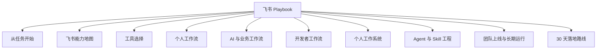

# 飞书 Playbook

从一件具体工作开始，把飞书真正用起来。按普通用户、个人开发者、团队负责人和 Agent 开发者的真实任务，搭建简报、会议、知识、Base、AI、自动化与开放平台工作流。

在线阅读：[chendahuang.com/playbook/feishu](https://chendahuang.com/playbook/feishu/)

## 全景图

## 目录

- [1. 先从你的任务开始](#_1-先从你的任务开始)
- [2. 飞书能力地图](#_2-飞书能力地图)
- [3. 工具怎么选](#_3-工具怎么选)
- [4. 六套个人工作流](#_4-六套个人工作流)
- [5. AI 与业务工作流](#_5-ai-与业务工作流)
- [6. 开发者工作流](#_6-开发者工作流)
- [7. 搭一套个人工作系统](#_7-个人工作系统)
- [8. Agent 与 Skill 工程](#_8-agent-与-skill-工程)
- [9. 团队上线与长期运行](#_9-团队上线与长期运行)
- [10. 30 天落地路线](#_10-30-天落地路线)
- [11. 参考项目与资料](#_11-参考项目与资料)

<main class="playbook-home">
  <section class="playbook-hero">
    

      <h1>飞书 Playbook</h1>
      
从一件具体工作开始，把飞书、AI 与 Agent 真正接进工作系统。

    

    

      <a class="playbook-action primary" href="./chapters/01-start">开始阅读<svg class="chapter-arrow" aria-hidden="true" viewBox="0 0 24 24" fill="none"><path d="M5 12h14M13 6l6 6-6 6" stroke="currentColor" stroke-width="1.8" stroke-linecap="round" stroke-linejoin="round"/></svg></a>
      <a class="playbook-action" href="#chapters">查看全部章节<svg class="chapter-arrow" aria-hidden="true" viewBox="0 0 24 24" fill="none"><path d="M5 12h14M13 6l6 6-6 6" stroke="currentColor" stroke-width="1.8" stroke-linecap="round" stroke-linejoin="round"/></svg></a>
    

  </section>

  <section class="playbook-section" id="chapters">
    

      <h2>按任务开始</h2>
      
选择当前最需要解决的问题，直接进入对应章节。

    

    

  <a class="chapter-link" href="./chapters/01-start">
    01
    <strong class="chapter-title">## 1. 先从你的任务开始</strong>按你的角色选路线，用 15 分钟跑通第一件真实任务。
    <svg class="chapter-arrow" aria-hidden="true" viewBox="0 0 24 24" fill="none"><path d="M5 12h14M13 6l6 6-6 6" stroke="currentColor" stroke-width="1.8" stroke-linecap="round" stroke-linejoin="round"/></svg>
  </a>
  <a class="chapter-link" href="./chapters/02-capability-map">
    02
    <strong class="chapter-title">## 2. 飞书能力地图</strong>理解消息、文档、Wiki、Base、任务、日历、妙记与 AI 的分工。
    <svg class="chapter-arrow" aria-hidden="true" viewBox="0 0 24 24" fill="none"><path d="M5 12h14M13 6l6 6-6 6" stroke="currentColor" stroke-width="1.8" stroke-linecap="round" stroke-linejoin="round"/></svg>
  </a>
  <a class="chapter-link" href="./chapters/03-tool-selection">
    03
    <strong class="chapter-title">## 3. 工具怎么选</strong>选择内置 AI、自动化、aily、CLI、MCP 或 OpenAPI。
    <svg class="chapter-arrow" aria-hidden="true" viewBox="0 0 24 24" fill="none"><path d="M5 12h14M13 6l6 6-6 6" stroke="currentColor" stroke-width="1.8" stroke-linecap="round" stroke-linejoin="round"/></svg>
  </a>
  <a class="chapter-link" href="./chapters/04-personal-workflows">
    04
    <strong class="chapter-title">## 4. 个人 AI 工作台：让知识进入行动</strong>搭建简报、会议、日程、CRM、项目记忆与内容发布。
    <svg class="chapter-arrow" aria-hidden="true" viewBox="0 0 24 24" fill="none"><path d="M5 12h14M13 6l6 6-6 6" stroke="currentColor" stroke-width="1.8" stroke-linecap="round" stroke-linejoin="round"/></svg>
  </a>
  <a class="chapter-link" href="./chapters/05-ai-business-workflows">
    05
    <strong class="chapter-title">## 5. AI 与业务工作流</strong>把 Base AI、aily、审批、OKR 与妙搭接进业务流程。
    <svg class="chapter-arrow" aria-hidden="true" viewBox="0 0 24 24" fill="none"><path d="M5 12h14M13 6l6 6-6 6" stroke="currentColor" stroke-width="1.8" stroke-linecap="round" stroke-linejoin="round"/></svg>
  </a>
  <a class="chapter-link" href="./chapters/06-developer-workflows">
    06
    <strong class="chapter-title">## 6. 开发者工作流</strong>构建机器人、事件订阅、Coding Agent 与混合数据系统。
    <svg class="chapter-arrow" aria-hidden="true" viewBox="0 0 24 24" fill="none"><path d="M5 12h14M13 6l6 6-6 6" stroke="currentColor" stroke-width="1.8" stroke-linecap="round" stroke-linejoin="round"/></svg>
  </a>
  <a class="chapter-link" href="./chapters/07-personal-work-system">
    07
    <strong class="chapter-title">## 7. 搭一套个人工作系统</strong>把收件箱、项目、任务、知识和复盘连成个人系统。
    <svg class="chapter-arrow" aria-hidden="true" viewBox="0 0 24 24" fill="none"><path d="M5 12h14M13 6l6 6-6 6" stroke="currentColor" stroke-width="1.8" stroke-linecap="round" stroke-linejoin="round"/></svg>
  </a>
  <a class="chapter-link" href="./chapters/08-agent-skill-engineering">
    08
    <strong class="chapter-title">## 8. Agent 与 Skill 工程</strong>设计可读、可写、可确认、可验证的 Agent Skill。
    <svg class="chapter-arrow" aria-hidden="true" viewBox="0 0 24 24" fill="none"><path d="M5 12h14M13 6l6 6-6 6" stroke="currentColor" stroke-width="1.8" stroke-linecap="round" stroke-linejoin="round"/></svg>
  </a>
  <a class="chapter-link" href="./chapters/09-team-operations">
    09
    <strong class="chapter-title">## 9. 团队上线与长期运行</strong>让权限、幂等、审计、配额、备份和指标长期稳定运行。
    <svg class="chapter-arrow" aria-hidden="true" viewBox="0 0 24 24" fill="none"><path d="M5 12h14M13 6l6 6-6 6" stroke="currentColor" stroke-width="1.8" stroke-linecap="round" stroke-linejoin="round"/></svg>
  </a>
  <a class="chapter-link" href="./chapters/10-thirty-day-plan">
    10
    <strong class="chapter-title">## 10. 30 天落地路线</strong>用四周时间从第一条流程推进到团队运行。
    <svg class="chapter-arrow" aria-hidden="true" viewBox="0 0 24 24" fill="none"><path d="M5 12h14M13 6l6 6-6 6" stroke="currentColor" stroke-width="1.8" stroke-linecap="round" stroke-linejoin="round"/></svg>
  </a>
  <a class="chapter-link" href="./chapters/11-references">
    11
    <strong class="chapter-title">## 11. 参考项目与资料</strong>集中查看官方工具、产品说明、案例与配额资料。
    <svg class="chapter-arrow" aria-hidden="true" viewBox="0 0 24 24" fill="none"><path d="M5 12h14M13 6l6 6-6 6" stroke="currentColor" stroke-width="1.8" stroke-linecap="round" stroke-linejoin="round"/></svg>
  </a>
  <a class="chapter-link" href="./chapters/12-conclusion">
    12
    <strong class="chapter-title">## 结语</strong>把信息、判断、动作和经验连成持续循环。
    <svg class="chapter-arrow" aria-hidden="true" viewBox="0 0 24 24" fill="none"><path d="M5 12h14M13 6l6 6-6 6" stroke="currentColor" stroke-width="1.8" stroke-linecap="round" stroke-linejoin="round"/></svg>
  </a>
    

  </section>

  <section class="playbook-section">
    

      <h2>全部 Playbook</h2>
      
同一套阅读系统，各自保留一个清晰主题。

    

    <nav class="playbook-family" aria-label="全部 Playbook">
      <a class="playbook-family-link" href="https://chendahuang.com/playbook/cloudflare/"><strong>Cloudflare</strong>开发、部署与生产运维</a>
      <a class="playbook-family-link" href="https://chendahuang.com/playbook/codex/"><strong>Codex</strong>长期协作与可靠交付</a>
      <a class="playbook-family-link" href="https://chendahuang.com/playbook/feishu/"><strong>飞书</strong>协作、AI 与 Agent 工作流</a>
      <a class="playbook-family-link" href="https://chendahuang.com/playbook/macos/"><strong>macOS</strong>软件、效率与系统维护</a>
    </nav>
  </section>
</main>
