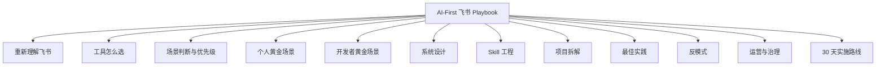
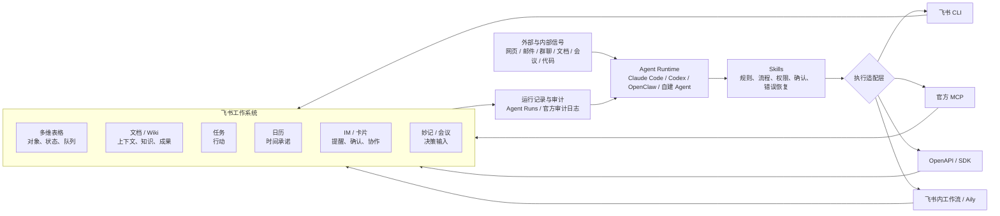
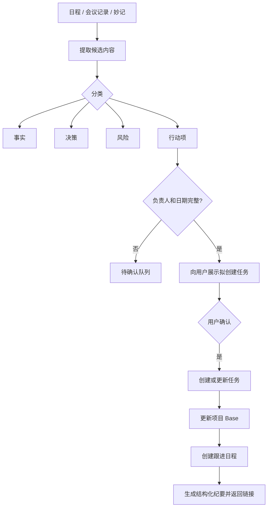

# 飞书 Playbook

AI-First 飞书个人与开发者 Playbook —— 把飞书变成你和 Agent 的工作操作系统。

在线阅读：[chendahuang.com/playbook/feishu](https://chendahuang.com/playbook/feishu/)

## 全景图



## 目录

- [1. 重新理解飞书](#_1-重新理解飞书)
- [2. 工具怎么选](#_2-工具怎么选)
- [3. 场景判断与优先级](#_3-场景判断与优先级)
- [4. 个人黄金场景](#_4-个人黄金场景)
- [5. 开发者黄金场景](#_5-开发者黄金场景)
- [6. 系统设计](#_6-系统设计)
- [7. Skill 工程](#_7-skill-工程)
- [8. 项目拆解](#_8-项目拆解)
- [9. 最佳实践](#_9-最佳实践)
- [10. 反模式](#_10-反模式)
- [11. 运营与治理](#_11-运营与治理)
- [12. 30 天实施路线](#_12-30-天实施路线)
- [13. 检查清单](#_13-检查清单)
- [14. 附录](#_14-附录)

## 1. 重新理解飞书

### 这份 Playbook 解决什么问题

飞书官方文档已经足够详细地解释了多维表格、文档、知识库、日历、任务、OpenAPI、CLI 和各类 AI 功能"分别能做什么"。真正缺少的不是另一份功能目录，而是下面这些更接近实践的问题：

1. **个人和开发者最值得先做哪些 AI + 飞书场景？**
2. **哪些开源项目和真实案例值得拆解，而不是只看产品演示？**
3. **飞书应该承担数据库、知识库、执行系统还是协作界面？**
4. **什么应该交给 AI，什么必须由人确认？**
5. **如何设计一个可靠的 Skill，而不是写一段很长的提示词？**
6. **免费版和开放平台额度下，什么方案能长期跑，什么方案很快会撞墙？**
7. **怎样避免重复记录、误发消息、权限过大、文档覆盖、API 浪费和知识幻觉？**

这份 Playbook 给出一套可直接采用的答案：

- 一套 AI-First 飞书的系统模型；
- 一张个人与开发者案例优先级地图；
- 8 个建议重点写入正式 Playbook 的"黄金场景"；
- 15+ 个值得研究的官方与社区项目；
- 一套多维表格、文档、任务、日历和消息的分工原则；
- 一套可复用的 Skill 工程规范；
- 一套安全、可靠性、成本与配额最佳实践；
- 一条从零到可运行系统的 30 天实施路线。

### 飞书最适合成为"工作操作层"

对个人和小团队而言，飞书最大的价值不是替代所有软件，而是把以下内容放到同一个可见、可协作的操作界面里：

<div class="play-grid">
  <div class="play-tile"><strong>多维表格</strong><span>对象、状态、关系和队列。项目、客户、信号、任务队列、运行记录。</span></div>
  <div class="play-tile"><strong>文档与知识库</strong><span>上下文、解释、方案、SOP 和最终成果。PRD、研究、纪要、报告、成稿。</span></div>
  <div class="play-tile"><strong>任务</strong><span>明确的行动。有负责人、有状态、有截止日期的行动项。</span></div>
  <div class="play-tile"><strong>日历</strong><span>真实的时间承诺。会议、跟进、深度工作、复查。</span></div>
  <div class="play-tile"><strong>消息与卡片</strong><span>提醒、确认、快速交互。审批式确认、摘要、异常。</span></div>
  <div class="play-tile"><strong>妙记与会议产物</strong><span>决策和行动的输入。逐字稿、摘要、待办、章节。</span></div>
  <div class="play-tile"><strong>CLI、MCP、OpenAPI</strong><span>Agent 的执行通道。200+ 命令，20+ 官方 Skills。</span></div>
  <div class="play-tile"><strong>本地数据库</strong><span>高频原始数据、日志、事务。SQLite、PostgreSQL、对象存储。</span></div>
</div>

大规模原始数据、高频事件、复杂事务和长期历史日志，通常更适合放在 SQLite、PostgreSQL、对象存储或专业数据系统中；飞书承接经过筛选后需要人查看、判断、修改和协作的状态。

这是一条贯穿全文的原则：

> **数据库负责保存世界，多维表格负责让人和 Agent 一起操作世界。**

### AI-First 飞书的系统模型



### 五层职责

| 层 | 主要职责 | 不应该承担的职责 |
|---|---|---|
| Agent 层 | 理解、规划、提取、归纳、生成 | 直接拥有无限权限 |
| Skill 层 | 流程、触发、约束、确认、恢复 | 变成一份无边界的长提示词 |
| 执行层 | 调用 CLI、MCP 或 API | 自行决定业务规则 |
| 飞书层 | 人机协作、状态、知识、动作 | 承载无限原始数据和复杂事务 |
| 治理层 | 权限、审计、配额、备份、评估 | 事后才补 |

### 一个好场景不是"AI 能做"，而是"AI 能闭环"

一个值得进入 Playbook 的场景，至少应包含以下四步：

```text
获取上下文 → 做出结构化判断 → 执行可验证动作 → 把结果写回系统
```

仅仅"总结一篇文档"不算完整场景；更完整的形式是：

```text
读取会议纪要
→ 识别决策、风险和行动项
→ 让用户确认负责人和截止日期
→ 创建任务
→ 更新项目状态
→ 安排复查日程
→ 返回所有结果链接
```

### Agent、Skill 和飞书各自承担不同职责

- **Agent**：理解意图、规划步骤、处理模糊信息；
- **Skill**：规定什么时候触发、读什么、怎么做、何时确认、失败如何恢复；
- **CLI / MCP / OpenAPI**：执行真实操作；
- **飞书**：承载上下文、状态、协作关系和结果；
- **人**：处理价值判断、冲突、外部沟通和高风险动作。

飞书官方 CLI 当前覆盖消息、文档、云盘、多维表格、日历、任务、邮箱、会议等核心业务域，并在仓库中列出 200+ 命令和 20+ Agent Skills；其中还包括 `lark-skill-maker`、会议纪要汇总和日程待办摘要等工作流 Skill。[^official-cli]

### 最值得先做的，不是"万能助手"

对个人和开发者，推荐优先顺序是：

1. 每日工作简报；
2. 会议到行动；
3. 日程安排助手；
4. Markdown 发布与备份；
5. 个人 CRM；
6. 项目记忆与带引用问答；
7. 行业信号与内容管道；
8. Coding Agent 飞书入口；
9. 多 Agent 团队；
10. 轻量业务系统。

前三项高频、边界清楚、失败成本低，最容易形成正反馈。

### "读—计划—确认—写—验证—报告"默认合同

所有写操作应遵循：

```text
Read      读取真实资源、结构、权限和当前状态
Plan      给出拟执行步骤和影响范围
Confirm   对中高风险动作取得明确确认
Write     执行最小必要写入
Verify    重新读取，确认结果真的落地
Report    返回链接、ID、变更摘要和未解决问题
```

这比让 Agent "直接帮我搞定"可靠得多。

### 飞书免费版可以做出完整系统，但不适合高频采集

截至本文快照日期（2026-07-12），基础版支持 100 名用户；云文档存储为认证前 15 GB、认证后 100 GB；多维表格基础权益通常以单表 2,000 行展示；基础版自动化与工作流共享每月 200 次运行额度；基础免费版企业自建应用 API 调用总量为每月 10,000 次。AI 额度则按具体产品、租户和权益动态变化，不能简单写成一个统一数字。[^pricing][^storage][^base-entitlement][^api-quota][^ai-quota]

因此，免费版最适合：

- 低频但高价值的工作流；
- 人工与 AI 共同维护的状态表；
- 经过筛选的知识和信号；
- 每日、每周、会后等周期性流程；
- 小规模 CRM、项目管理和内容系统。

不适合：

- 每分钟轮询消息；
- 每天写入几万条原始数据；
- 把所有网页全文、聊天和日志直接塞进 Base；
- 无筛选地为每个事件触发多步 Agent。

### 飞书和同类工具的区别

| 工具 | 核心定位 | 适合什么 | 不适合什么 |
| --- | --- | --- | --- |
| 飞书 | 一体化协作平台 + AI-First 工作操作层 | 需要 IM + 文档 + 流程 + Agent 深度耦合的团队 | 只想要一个 IM 工具 |
| 钉钉 | 企业数字化平台 | 中大型企业的考勤、审批和 ERP 对接 | 偏重内容创作的轻量团队 |
| 企微 | 客户连接工具 | 销售、客服、私域运营 | 深度文档协作 |
| Notion | 知识库与文档 | 个人和团队的知识管理和项目管理 | 需要即时通讯和审批 |
| Slack | 即时通讯 | 以 IM 为中心的协作 | 需要文档和流程管理 |
| Teams | Office 生态协作 | 深度使用 Microsoft 365 的组织 | 不想绑定微软生态 |
| Lark（国际版） | 飞书海外版 | 跨境团队 | 国内合规要求高的场景 |

选择标准：如果你的团队既需要即时通讯，又需要文档协作、项目管理、审批流程，且希望它们与 Agent 深度联动，飞书是最合适的选择。

## 2. 工具怎么选

### 决策表

| 方案 | 最适合 | 优点 | 主要代价 |
|---|---|---|---|
| 官方飞书 CLI | 个人开发者、Coding Agent、快速原型 | 覆盖广、结构化输出、内置 Skills、可被任何能执行命令的 Agent 调用 | 需要本地运行环境和授权 |
| 官方 OpenAPI MCP | 原生支持 MCP 的客户端 | 工具发现自然、接入标准化 | 项目仍标注 Beta，工具面和客户端行为需持续验证[^official-mcp] |
| 官方 OpenClaw 插件 | 已使用 OpenClaw、希望在飞书聊天中操作 | 消息、文档、Base、日历、任务一体化，支持流式卡片、敏感操作确认和群级策略[^official-openclaw] | 与 OpenClaw 运行时绑定 |
| OpenAPI / SDK | 稳定服务、后台系统、高频集成 | 控制最强、易做队列、重试、监控和服务化 | 开发与维护成本最高 |
| 多维表格工作流 / Aily | 流程主要发生在飞书内部 | 业务用户易维护，天然接近数据 | 额度、复杂度和跨系统能力受产品边界影响 |
| 社区 MCP / CLI | 官方能力缺口、深度文档编辑、实验 | 某些能力更细、更贴近具体工作流 | 需要自行审计安全、维护状态和兼容性 |

### 对个人开发者的默认建议

```text
第一选择：官方 CLI + 官方 Skills
第二选择：针对缺口补官方 MCP 或社区工具
需要长期服务化时：迁移到 OpenAPI / SDK
已使用 OpenClaw：优先官方插件
高频采集：本地数据库 + 批量同步飞书
```

飞书官方 `lark-skill-maker` 给出的调用优先级也是：**Shortcut > 已注册 API > 裸 OpenAPI**；它同时要求 Skill 写清权限、写操作确认、`dry-run` 预览、步骤间数据传递、失败回滚和可并行步骤。[^skill-maker]

### 飞书各模块的正确分工

| 模块 | 最适合回答的问题 | 典型内容 |
|---|---|---|
| 多维表格 | 有哪些对象？当前处于什么状态？ | 项目、客户、信号、任务队列、运行记录 |
| 文档 | 为什么？具体内容是什么？ | PRD、研究、SOP、纪要、报告、成稿 |
| 知识库 | 哪些内容是正式、可长期引用的知识？ | 项目 Wiki、领域知识、Playbook |
| 任务 | 下一步明确要完成什么？ | 有负责人、有状态的行动项 |
| 日历 | 什么时候真的投入时间？ | 会议、跟进、深度工作、复查 |
| 消息与卡片 | 什么现在必须被看到或确认？ | 提醒、审批式确认、摘要、异常 |
| 妙记 | 会上说了什么，产生了什么候选结论？ | 逐字稿、摘要、待办、章节 |
| 本地数据库 | 哪些数据量大、频率高、需要事务？ | 抓取结果、日志、原始事件、模型缓存 |

### 官方 CLI 快速开始

```bash
# 安装
npx @larksuite/cli@latest install

# 初始化配置（创建新应用或绑定已有应用）
lark-cli config init --new

# 登录授权（推荐 user 身份）
lark-cli auth login --recommend

# 检查认证状态与 scope
lark-cli auth status

# 查看所有可用命令
lark-cli --help

# 查看某个业务域命令
lark-cli calendar --help
lark-cli task --help
lark-cli base --help
```

具体命令可能随版本变化，正式发布时应链接官方仓库而不是复制过多静态说明。[^official-cli]

### 飞书 API 的核心概念

| 概念 | 说明 | 注意事项 |
|---|---|---|
| tenant_access_token | 应用级别的访问令牌 | 有效期 2 小时，需缓存和刷新 |
| user_access_token | 用户级别的访问令牌 | 代表用户操作，权限受用户授权范围限制 |
| app_access_token | 应用访问租户的令牌 | 用于获取 tenant_access_token |
| API 限流 | 不同接口有不同的 QPS 限制 | 要处理 429，尊重 retry-after |
| scope | 权限范围 | 最小权限原则，不要一次性申请所有 scope |
| 事件订阅 | 监听飞书事件 | 事件优于轮询，需要验证和去重 |

## 3. 场景判断与优先级

### 六个评分维度

每个候选场景按 1—5 分评估：

| 维度 | 高分意味着 |
|---|---|
| 频率 | 每天或每周反复发生 |
| 上下文碎片度 | 信息散在多个模块和来源 |
| 结构化程度 | 输入与结果可形成稳定字段 |
| 可执行性 | 结果可以创建任务、更新状态或安排时间 |
| 可验证性 | 写入后能通过 ID、链接和状态检查 |
| 风险可控性 | 可以预览、确认、回滚或限制范围 |

一个好场景通常具备：

```text
高频 + 上下文分散 + 结果结构化 + 动作可验证 + 风险可控
```

### 案例优先级地图

| 场景 | 个人价值 | 实现复杂度 | 风险 | 免费版适配 | 建议 |
|---|---:|---:|---:|---:|---|
| 每日工作简报 | 5 | 1 | 1 | 5 | 第一个做 |
| 会议到行动 | 5 | 3 | 3 | 5 | 第二个做 |
| 日程安排助手 | 4 | 2 | 3 | 5 | 尽早做 |
| Markdown 发布与备份 | 4 | 3 | 2 | 5 | 开发者优先 |
| 个人 CRM | 4 | 3 | 3 | 4 | 有稳定沟通量后做 |
| 项目记忆与引用问答 | 5 | 4 | 2 | 4 | 知识工作者优先 |
| 行业信号与内容管道 | 5 | 4 | 2 | 3 | 先控制数据量 |
| Coding Agent 飞书入口 | 5 | 4 | 5 | 3 | 工程师进阶 |
| 多 Agent 机器人团队 | 4 | 5 | 4 | 2 | 不宜过早 |
| 轻量业务系统 | 5 | 5 | 4 | 2 | 验证后再扩展 |

## 4. 个人黄金场景

### 场景一：每日工作简报

#### 要解决的问题

每天开始工作时，信息通常分散在：

- 日历里的会议；
- 任务里的待办；
- 多维表格里的项目状态；
- 邮件和群聊里的临时承诺；
- 昨天没有完成的事项。

普通"早报"容易变成信息堆砌。真正有价值的简报应该回答：

1. 今天有哪些不可移动的时间承诺？
2. 哪些任务今天到期或已经逾期？
3. 哪些会议存在冲突？
4. 哪个项目没有下一步行动？
5. 今天最值得完成的三件事是什么？

#### 最小可用流程

```text
读取今日日程
+ 读取未完成任务
→ 按时间和截止日期排序
→ 检测冲突与逾期
→ 输出 3 个优先行动
→ 发送到个人聊天或生成卡片
```

官方仓库中的 `lark-workflow-standup-report` 已经展示了一个很好的基础模式：并行读取日程与未完成任务，显式过滤已完成任务，再由 AI 完成时间转换、冲突检测和摘要。[^standup-skill]

#### CLI 调用示例

```bash
# 读取今日日程
lark-cli calendar list --start "$(date -d 'today 00:00' +%s)" \
  --end "$(date -d 'today 23:59' +%s)" --format json

# 读取未完成任务
lark-cli task list --status incomplete --format json

# 发送简报到个人聊天
lark-cli message send --user self --text "今日简报已生成" --card card.json
```

#### 推荐输出

```markdown
## 今日工作简报

### 时间承诺
- 10:00–11:00 产品评审
- 15:00–16:00 客户同步

### 必须处理
- [逾期] 提交报价方案
- [今天到期] 确认发布清单

### 风险
- 15:00 的会议与深度工作块冲突
- 项目 Alpha 已 7 天没有下一步行动

### 建议
1. 09:00–09:45 完成报价方案
2. 评审后立即确认 Alpha 的负责人
3. 17:30 做 10 分钟收尾复盘
```

#### 最佳实践

- 只展示需要决策或行动的信息，不复制全部日程；
- 对任务必须显式过滤"未完成"；
- 无截止日期的历史任务要折叠；
- 只在用户授权的日期范围内读取；
- 简报可以自动生成，但不应该自动改动日程；
- 把"信息摘要"和"行动建议"分开。

#### 进阶玩法

- **周报模式**：汇总一周的完成情况、逾期情况和项目健康度；
- **个人 OKR 追踪**：把简报关联到 OKR 进度，每天提醒关键结果；
- **能量管理**：根据日程密度建议深度工作块；
- **多日历合并**：合并个人日历、工作日历和订阅日历；
- **简报卡片化**：用交互式卡片让用户一键确认或推迟行动。

#### 衡量指标

- 每天规划所需时间；
- 被提前发现的日程冲突数；
- 逾期任务比例；
- 简报建议被采纳的比例；
- 没有下一步行动的活跃项目数量。

### 场景二：会议到行动

#### 要解决的问题

很多会议已经有录音、转写和 AI 摘要，但仍然没有形成执行闭环：

- "讨论了"被误写成"决定了"；
- 待办没有负责人；
- 负责人有了但没有截止日期；
- 相同待办被重复创建；
- 任务创建后没有回到项目状态；
- 下次会议仍然从头讨论。

#### 推荐流程



社区项目 `lark-workflow-feishu-cli` 给出了"从妙记提取待办—通过消息确认—创建任务—持续检查"的完整示例，适合作为实现参考。[^workflow-pack]

#### 必须明确的业务规则

- 只有明确承诺的内容才标为"决策"；
- 不推断负责人；
- 不臆造截止日期；
- 缺失字段进入"待确认"，而不是直接写入正式任务；
- 创建任务前先按会议 ID、文本摘要和负责人检查重复；
- 同一个会议重复运行时应更新已有记录；
- 会议摘要不是事实源本身，关键结论应保留原文或时间戳链接。

#### 推荐幂等键

```text
meeting_id + normalized_action_text + owner_id
```

或者：

```text
source_type + source_id + action_hash
```

#### 风险等级

| 动作 | 风险 | 默认策略 |
|---|---|---|
| 读取妙记 | 低 | 可直接执行 |
| 生成候选行动项 | 低 | 可直接执行 |
| 创建个人任务 | 中 | 展示后确认或执行后报告 |
| 给他人分配任务 | 高 | 必须确认 |
| 发送会议总结 | 高 | 必须确认收件范围 |
| 创建外部参与者日程 | 高 | 必须确认 |

#### 衡量指标

- 会议结束到任务创建的时间；
- 有负责人和截止日期的行动项比例；
- 重复任务率；
- 下一次会议重复讨论同一问题的比例；
- 逾期行动项比例。

### 场景三：日程安排助手

#### 要解决的问题

安排会议并不是简单地"找一个空位"，还涉及：

- 联系人身份解析；
- 多人忙闲；
- 时区；
- 工作时间；
- 会议缓冲；
- 会议室；
- 外部参与者；
- 是否需要附加材料；
- 是否需要发送消息。

#### 推荐流程

```text
识别参会人
→ 读取目标日期与时区
→ 查询忙闲
→ 应用工作时间、缓冲和时长规则
→ 返回 2—3 个候选
→ 用户选择
→ 创建日程
→ 附加会议材料
→ 验证参会人和时间
→ 返回链接
```

`Feishu-CLI-Web` 的示例很好地展示了"搜索联系人—查询共同空闲—创建会议—邀请参会人—发送链接"，并且在真正写入之前展示执行计划和要求确认。[^cli-web]

#### 最佳实践

- 所有时间都转换成绝对日期、时间和时区；
- 不能仅凭姓名猜联系人，多候选时消歧；
- 默认避开工作时间边界和连续会议；
- 不替用户自动接受邀请；
- 对外部参与者、会议室和消息发送必须确认；
- 创建后重新读取日程，验证时间、参会人和 RSVP；
- "任务截止日"与"日历时间块"分开管理。

#### 一个推荐的个人规则集

```yaml
working_hours:
  monday_friday: "09:30-18:30"
  weekend: off
meeting_buffer_minutes: 15
default_meeting_duration_minutes: 45
deep_work_blocks:
  - "09:30-11:30"
  - "14:00-16:00"
external_invite_requires_confirmation: true
same_day_meeting_requires_confirmation: true
max_meetings_per_day: 6
lunch_protect: true
timezone: Asia/Shanghai
```

#### 衡量指标

- 安排一次会议所需的往返沟通次数；
- 自动发现的时间冲突数；
- 被拒绝的会议邀请比例；
- 会议密度（每天会议总时长）。

### 场景四：个人 CRM

#### 要解决的问题

个人 CRM 不是把通讯录搬到表格，而是回答：

- 我最近和谁有过有意义的互动？
- 哪些重要关系长时间没有跟进？
- 上次谈到了什么？
- 我答应了什么？
- 下一步应该在什么时候联系？
- 关系判断依据是什么？

#### 推荐数据模型

##### Contacts

| 字段 | 类型 | 说明 |
|---|---|---|
| contact_id | 文本 | 稳定主键 |
| 姓名 | 文本 | 显示名称 |
| 公司 / 组织 | 文本 | 所属机构 |
| 角色 | 单选 | 决策者、合作伙伴、朋友等 |
| 重要程度 | 单选 | 人工设定：高、中、低 |
| 最后互动时间 | 日期 | 从互动表聚合 |
| 下一次跟进 | 日期 | 计划时间 |
| 关系健康度 | 公式 | 启发式评分，不作为事实 |
| 备注文档 | URL / 关联 | 关联文档 |
| 状态 | 单选 | 活跃、低频、暂停、归档 |
| source_id | 文本 | 飞书用户 ID 或外部 ID |

##### Interactions

| 字段 | 类型 | 说明 |
|---|---|---|
| interaction_id | 文本 | 稳定主键 |
| contact_id | 关联 | 关联联系人 |
| 时间 | 日期时间 | 互动发生时间 |
| 类型 | 单选 | 邮件、会议、消息、线下 |
| 摘要 | 长文本 | AI 提取后的摘要 |
| 来源链接 | URL | 可追溯证据 |
| 承诺事项 | 长文本 | 双方承诺 |
| 是否需跟进 | 复选框 | 布尔值 |
| source_id | 文本 | 原始事件 ID |
| evidence_status | 单选 | 未验证、部分验证、已验证 |

#### 推荐流程

```text
增量读取授权范围内的邮件、日历或消息
→ 过滤广告和系统通知
→ 识别联系人与互动
→ 写入 Interaction
→ 更新最后互动时间
→ 计算关系健康度
→ 生成待跟进候选
→ 用户确认后创建任务或日程
```

`lark-workflow-feishu-cli` 中的个人 CRM 示例包含联系人表、互动记录表、关系热度和超期提醒，是很好的场景起点。[^workflow-pack]

#### 最佳实践

- 不一次性导入全部历史邮件；
- 重要程度必须允许人工覆盖；
- "关系健康度"应显示计算规则；
- 不把邮件频率直接等同于关系质量；
- 发送消息、邮件或邀请前必须确认；
- 对敏感联系人使用独立视图和更严格权限；
- 支持"不要再跟踪此联系人"。

#### 免费版适配

个人 CRM 通常很适合免费版。真正容易增长的是互动记录表，因此应：

- 只存摘要与来源，不复制全部邮件正文；
- 每季度归档低价值互动；
- 对高频历史使用外部数据库，Base 只保留最近窗口和汇总。

### 场景五：项目记忆与带引用问答

#### 要解决的问题

项目知识往往散在文档、群聊、会议、PDF 和临时消息中。传统知识库的最大问题不是搜不到，而是：

- 不知道哪份是最新版；
- 结论没有来源；
- 不同资料互相冲突；
- 项目新人不知道先看什么；
- AI 回答时把推断当成事实。

社区项目"文档搭子"提出了一套很值得学习的原则：把资料整理成项目 Wiki，维护需求、风险、承诺、决策、人物、来源和待确认问题；回答时只使用带引用的证据，发现冲突时不自行猜测，而是进入待确认队列。[^document-buddy]

#### 推荐 Wiki 结构

```text
项目名称/
├── 00 项目总览
├── 10 目标与范围
├── 20 需求
├── 30 决策记录
├── 40 风险与问题
├── 50 承诺与行动
├── 60 人物与协作关系
├── 70 会议与沟通
├── 80 来源清单
└── 90 待确认问题
```

#### 证据优先规则

- 没有来源，不写成确定事实；
- 推断必须标为"推断"；
- 冲突信息并列展示；
- 重要结论保存原始文档链接、消息链接或会议时间戳；
- 正式 Wiki 与"待整理收件箱"分开；
- 更新已有结论时保留变更原因和来源。

#### 推荐问答输出

```markdown
## 回答

当前确认的客户预算是 **10–12 万元区间**，但资料存在冲突，尚未得到最终确认。

### 已确认
- 采购负责人在 6 月 18 日会议中表示预算上限接近 12 万元。[来源]
- 早期需求文档仍记录为 10 万元。[来源]

### 待确认
- 最终预算是否已经在 6 月 18 日之后完成审批。

### 建议下一步
- 在下次客户会议中明确预算口径，并更新《项目总览》和《决策记录》。
```

#### 最适合的用户

- 咨询顾问；
- 产品经理；
- 客户成功；
- 研究人员；
- 多项目并行的独立开发者；
- 经常需要交接项目的团队。

### 场景六：Markdown 发布、双向同步与备份

#### 要解决的问题

开发者常在本地 Markdown、Git 仓库和飞书之间来回复制：

- 本地版本和飞书版本不一致；
- 图片与附件丢失；
- 重复创建文档；
- 更新时覆盖他人修改；
- 知识库没有可靠备份；
- 文档没有版本和映射关系。

飞书官方案例展示了用 Agent 把本地 Markdown 创建为飞书文档并归档到知识库；社区的 `feishu-docx` 支持文档、Wiki、Sheet 和 Base 导出到 Markdown，也支持创建、追加和更新指定 Block；`asknow` 中的 `feishu-sync` Skill 则展示了本地知识库到飞书 Wiki 或云文档的增量同步设计。[^doc-publish][^feishu-docx][^asknow-sync]

#### 必须先选择"唯一主源"

| 模式 | 主源 | 适合 |
|---|---|---|
| Local-first | Git / Markdown | 开发者、版本控制、自动发布 |
| Feishu-first | 飞书 Wiki / Docs | 团队协作、非技术编辑 |
| One-way mirror | 一侧主源，另一侧只读镜像 | 最稳妥的备份与发布 |

最危险的是在没有冲突策略的情况下做"自由双向同步"。

#### 推荐映射文件

```yaml
documents:
  - local_path: "playbook/index.md"
    feishu_type: "wiki"
    feishu_token: "wikcn_xxx"
    last_synced_hash: "sha256:..."
    last_synced_revision: "..."
    sync_direction: "local_to_feishu"
    conflict_policy: "stop_and_ask"
  - local_path: "docs/architecture.md"
    feishu_type: "doc"
    feishu_token: "doxcn_xxx"
    last_synced_hash: "sha256:..."
    sync_direction: "bidirectional"
    conflict_policy: "feishu_wins"
```

#### 更新规则

- 创建前先查映射，避免重复文档；
- 更新前比较本地哈希和远端 revision；
- 两侧都修改时停止并提示冲突；
- 局部编辑优先，不默认覆盖整篇；
- 图片、附件和内部链接单独处理；
- 每次同步记录文档 ID、版本和结果；
- 删除操作默认禁用；
- 备份应保留目录结构和相对链接。

#### 推荐产物

- 本地 Markdown；
- 飞书 Wiki 正式页面；
- `FEISHU_MAP.yml`；
- 同步日志；
- 每周自动导出的备份包；
- Git commit 或版本标签。

## 5. 开发者黄金场景

### 场景七：行业信号与内容生产管道

#### 要解决的问题

AI 可以抓取很多信息，但抓得多不等于判断得好。常见失败包括：

- 同一事件被多次写入；
- 把媒体转述当成官方事实；
- 只看热度，不看真实性；
- 缺少来源层级；
- 选题判断无法复盘；
- 最终文章与原始证据脱节。

飞书官方分享的热点追踪实践提出了一个非常值得复用的结构：Agent 抓取和初步整理，CLI 负责写入，多维表格承接证据、状态和人工判断，IM 推送重点候选，后续 AI 基于历史记录辅助选题与写作。[^hotspot-case]

#### 推荐信源分层

| 层级 | 作用 | 示例 |
|---|---|---|
| S0 官方事实源 | 证明事件真实发生 | 官网、官方博客、Release、公告 |
| S1 官方扩散源 | 捕捉官方传播与用户追问 | 官方社媒、公众号 |
| S2 社区验证源 | 验证采用、问题和真实需求 | GitHub、HN、Reddit、论坛 |
| S3 媒体与内容源 | 识别二次扩散和内容机会 | 媒体、KOL、教程、视频 |

#### 推荐表结构

1. **Sources**：信源、类型、抓取方式、健康状态、最后抓取时间；
2. **Raw Signals**：每条原始证据，包含 URL、标题、摘要、来源层级、时间戳、内容指纹；
3. **Events**：合并后的事件，关联多条 Signal，有事件键；
4. **Topics**：选题、角度、受众、状态、关联事件；
5. **Runs**：每轮抓取、错误和成本；
6. **Content**：文章、长帖、脚本和发布结果。

#### 推荐流程

```text
采集
→ 标准化 URL 和时间
→ 内容指纹去重
→ 按事件聚类
→ 寻找 S0 事实源
→ 计算证据状态
→ 人工复核
→ 进入选题池
→ AI 生成角度和大纲
→ 文档协作
→ 发布与复盘
```

#### 关键架构选择

不要把所有原始抓取结果直接写入 Base。更稳的架构是：

```text
抓取器 / RSS / API
→ SQLite / PostgreSQL 保存原始数据
→ 规则过滤与去重
→ 只把候选事件和证据摘要同步到 Base
→ 人在飞书里判断
```

这种模式既能控制 API 调用，也能避免很快撞到行数上限。

#### 衡量指标

- 有 S0 来源的事件比例；
- 重复事件率；
- 候选到选题的转化率；
- 选题到成稿的转化率；
- 每篇内容可追溯来源数；
- 被撤回或更正的事实数；
- 每个有效选题消耗的 API 调用和模型成本。

### 场景八：把 Coding Agent 接回飞书

#### 要解决的问题

Coding Agent 通常只存在于本地终端：

- 产品需求在群里，执行在终端；
- 手机上无法继续会话；
- 多个项目和 session 难管理；
- 结果要手动复制成文档；
- 团队看不到 Agent 当前在做什么；
- 高风险工具调用缺少交互确认。

`Lark Coding Agent Bridge` 把飞书消息桥接到本地 Claude Code 或 Codex，支持流式卡片、每个聊天或话题独立 session、队列、工作区切换以及图片和文件输入。飞书官方也发布了对应实践文章。[^coding-bridge][^coding-bridge-case]

#### 推荐会话模型

```text
一个群 = 一个项目
一个话题 / Thread = 一个独立工作会话
一个文档评论线程 = 一个具体审阅任务
```

#### 推荐协作流程

```text
群里提出需求
→ Agent 生成计划卡片
→ 人确认范围
→ Agent 在受限工作区执行
→ 流式报告进度
→ 生成飞书文档或 PR 摘要
→ 人进行最终合并或发布
```

#### 必须增加的安全边界

- 群和用户白名单；
- 工作目录白名单；
- 禁止读取 `.env`、密钥目录和无关项目；
- Shell 命令按风险分类；
- 删除、发布、推送、部署必须确认；
- 生产环境凭证与 Agent 环境隔离；
- 每个群绑定明确项目；
- 会话过期与手动 `/new`；
- 记录所有工具调用；
- 复杂任务在沙箱中运行。

#### 不适合的做法

- 让任何群成员都能触发任意 Shell；
- 一个 Agent 同时拥有所有飞书与基础设施权限；
- 把思考过程、密钥或内部日志直接发到群里；
- 在没有计划预览的情况下自动部署；
- 用聊天记录作为唯一项目状态。

### 场景九：事件驱动机器人

#### 要解决的问题

很多场景不需要 Coding Agent 那么重，但比定时简报更实时：

- 新妙记生成后自动进入处理队列；
- 多维表格状态变化后通知下游；
- 收到特定群消息后创建收件箱记录；
- 审批状态变更后触发后续流程；
- 新成员加入后发送欢迎消息。

飞书事件订阅 + Agent 子进程的组合，可以做出比轮询更高效、比工作流更灵活的事件驱动系统。

#### 推荐架构

```text
飞书事件订阅
→ 事件消费者（Agent 子进程）
→ 事件 schema 校验
→ 按 EventKey 路由到对应 Skill
→ 执行业务逻辑
→ 写回飞书
→ 记录 Agent Run
```

#### 官方 `lark-event` Skill 的关键规则

- 先读取事件 schema，再写过滤规则；
- 使用结构化错误类型，不匹配模糊报错字符串；
- 用 ready marker 判断消费者真的就绪，不依赖固定 sleep；
- 开发和测试时使用 `--max-events` 或 `--timeout`；
- 用 SIGTERM 或关闭 stdin 优雅退出；
- 避免强制 `kill -9`，否则可能遗留服务端订阅；
- 一个消费者处理一种 EventKey，便于隔离故障。[^event-skill]

#### 一个事件消费者的最小骨架

```bash
# 启动事件消费者
lark-cli event consume \
  --event-key "im.message.receive_v1" \
  --handler "skills/inbox-handler/SKILL.md" \
  --max-events 100 \
  --timeout 3600

# 优雅退出：发送 SIGTERM
kill -TERM $PID
```

#### 衡量指标

- 事件到达到处理完成的时间；
- 事件丢失率；
- 重复处理率；
- 消费者重启次数；
- 队列积压长度。

### 场景十：本地数据库 + Base 看板

#### 要解决的问题

有些业务的数据量、事务需求和查询复杂度，超出多维表格的承载能力，但团队又需要飞书的协作和移动查看能力。

#### 推荐混合架构

```text
本地数据库（SQLite / PostgreSQL）
→ 保存高频原始数据
→ 规则过滤与去重
→ 批量同步候选结果到 Base
→ 飞书作为移动看板和协作界面
→ 人工判断和决策在飞书完成
→ 决策结果回写数据库
```

`Auto-JobHunter` 用 SQLite 保存和处理高频数据，飞书多维表格作为移动端岗位看板；`mealoptima` 让 Base 承载业务数据和协作，通过自动化触发外部 AI 服务，再把结果回写。[^auto-job][^mealoptima]

#### 什么时候用数据库，什么时候用 Base

| 条件 | 推荐 |
|---|---|
| 每天新增超过数百条 | 数据库 |
| 需要事务 | 数据库 |
| 需要复杂 JOIN | 数据库 |
| 需要全文索引 | 数据库 |
| 需要长期保存每次模型中间结果 | 数据库 |
| 需要高频写入 | 数据库 |
| 需要严格的数据保留策略 | 数据库 |
| 需要人查看和协作 | Base |
| 需要移动端访问 | Base |
| 需要状态机和视图 | Base |
| 需要团队共同维护 | Base |

#### 同步策略

- **单向同步**：数据库 → Base，定时批量推送候选结果；
- **双向同步**：需要冲突策略，复杂度高，谨慎使用；
- **增量游标**：用 `updated_at` 或 `cursor` 字段做增量；
- **批量写入**：用 Base 的批量创建 API 减少调用次数；
- **归档策略**：定期把旧数据从 Base 归档到数据库。

### 场景十一：多用户 Agent 工作台

#### 要解决的问题

当 Agent 从个人工具扩展到团队工具时，直接给所有成员一个终端是不现实的：

- 不同成员有不同权限；
- 需要执行记录和审计；
- 需要场景模板沉淀团队流程；
- 需要计划预览和写操作确认；
- 需要多用户隔离。

`Feishu-CLI-Web` 展示了关键能力：先显示执行计划、写操作要求确认、每个用户使用独立授权和 HOME、保存对话与执行记录、用场景模板沉淀团队流程。[^cli-web]

#### 推荐架构

```text
飞书聊天 / Web 界面
→ 用户身份解析
→ 权限检查
→ 场景模板选择
→ Agent 生成执行计划
→ 用户确认
→ 在隔离 HOME 中执行
→ 写回飞书
→ 保存执行记录
→ 审计日志
```

#### 团队部署前必须完成

- 完整安全审计；
- 每个用户的权限范围；
- 场景模板的白名单；
- 执行记录的保留策略；
- 失败运行的告警机制；
- 紧急停用方案。

### 场景十二：多 Agent 分工

#### 要解决的问题

一个 Agent 做所有事，权限过大、上下文过长、难以测试。更好的方式是让多个 Agent 各自负责一个领域。

#### 推荐分工模型

| Agent | 职责 | 权限范围 |
|---|---|---|
| 简报 Agent | 读取日历和任务，生成简报 | 只读日历和任务 |
| 会议 Agent | 处理妙记，提取行动项 | 读取妙记，创建任务 |
| 日程 Agent | 安排会议，管理日历 | 读写日历 |
| CRM Agent | 维护联系人，提醒跟进 | 读写 CRM 表 |
| 信号 Agent | 抓取和筛选信号 | 读写信号表 |
| 内容 Agent | 辅助选题和写作 | 读写内容表和文档 |

`awesome-lark-bots` 项目展示了多 Agent 分工和低权限聊天入口的探索。[^awesome-bots]

#### 协调原则

- 每个 Agent 只有一个核心职责；
- Agent 之间通过 Base 或消息传递，不直接调用；
- 每个 Agent 有独立权限和凭证；
- 失败隔离，一个 Agent 挂了不影响其他；
- 统一的 Agent Runs 记录所有运行。

## 6. 系统设计

### 建议的最小个人工作系统

为了避免一开始建十几张表，建议先建立一个 Base，包含四张核心表。

#### Projects

| 字段 | 类型 | 说明 |
|---|---|---|
| project_id | 文本 | 不变的业务主键 |
| 项目名称 | 文本 | 人类可读名称 |
| 状态 | 单选 | 规划中、进行中、阻塞、完成、归档 |
| 目标 | 长文本 | 成功标准 |
| 下一步行动 | 文本 | 必须具体 |
| 负责人 | 人员 | 个人系统可为自己 |
| 截止日期 | 日期 | 项目承诺 |
| 健康状态 | 单选 | 绿、黄、红 |
| 相关文档 | URL / 关联 | 项目 Wiki |
| 最近活动时间 | 日期 | 由事件或人工更新 |
| source_of_truth | 单选 | Base、Git、外部系统 |

#### Actions

| 字段 | 类型 | 说明 |
|---|---|---|
| action_id | 文本 | 稳定主键 |
| 标题 | 文本 | 可执行动作 |
| 所属项目 | 关联 | 关联 Projects |
| 负责人 | 人员 | 不为空 |
| 截止日期 | 日期 | 可为空但要进入待确认 |
| 状态 | 单选 | 候选、已确认、进行中、完成、取消 |
| 来源类型 | 单选 | 会议、消息、文档、人工 |
| source_id | 文本 | 原始对象 ID |
| dedup_key | 文本 | 幂等键 |
| 飞书任务 ID | 文本 | 创建后写回 |
| 日历事件 ID | 文本 | 排期后写回 |
| 验证状态 | 单选 | 未验证、已验证、失败 |

#### Signals

| 字段 | 类型 | 说明 |
|---|---|---|
| signal_id | 文本 | 稳定主键 |
| 标题 | 文本 | 信号标题 |
| 来源 URL | URL | 原始证据 |
| 来源层级 | 单选 | S0、S1、S2、S3 |
| 事件键 | 文本 | 聚合同一事件 |
| 摘要 | 长文本 | 结构化摘要 |
| 证据状态 | 单选 | 未验证、部分验证、已验证、冲突 |
| 相关性 | 数字 | 业务相关性 |
| 状态 | 单选 | 收件箱、复核、候选、采用、归档 |
| 相关项目 / 选题 | 关联 | 下游用途 |

#### Agent Runs

| 字段 | 类型 | 说明 |
|---|---|---|
| run_id | 文本 | 每次运行唯一 ID |
| skill_name | 文本 | Skill 名称与版本 |
| trigger | 文本 | 人工、定时、事件 |
| actor | 文本 | 用户身份或应用身份 |
| input_summary | 长文本 | 输入摘要，不保存不必要敏感内容 |
| read_set | 长文本 | 读取对象与范围 |
| planned_writes | 长文本 | 拟写入内容 |
| actual_writes | 长文本 | 实际变更与对象 ID |
| status | 单选 | 成功、部分成功、失败、取消 |
| error_type | 文本 | 结构化错误 |
| api_call_estimate | 数字 | 估算调用量 |
| started_at / ended_at | 日期时间 | 运行区间 |
| needs_review | 复选框 | 是否需人工复核 |

### 推荐视图

- **Today**：今天到期、逾期和已排期行动；
- **Needs Confirmation**：负责人、日期、目标资源不明确的候选；
- **Stale Projects**：超过 7 天无活动且仍在进行；
- **Unverified Signals**：没有 S0 或存在冲突；
- **Failed Agent Runs**：失败和部分成功；
- **Upcoming Follow-ups**：未来 14 天关系跟进；
- **Archive Queue**：准备归档的旧数据；
- **Overdue Actions**：已逾期的行动项；
- **High-Risk Pending**：等待高风险确认的操作；
- **Weekly Review**：本周完成的行动和项目变化。

### 推荐知识库目录

```text
00 Inbox
10 Projects
20 Domains
30 Decisions
40 Playbooks
50 Research
60 Content
90 Reviews
99 Archive
```

每篇正式文档建议带一个简短元数据区：

```yaml
owner: your-name
status: draft | reviewed | canonical | archived
source_of_truth: feishu
last_reviewed: 2026-07-12
related_project_id: PRJ-001
sources:
  - ...
```

### 日历使用规则

- Backlog 不进日历；
- 只有已经承诺投入时间的任务才进入日历；
- 自动排期只生成建议，不直接覆盖已有日程；
- 周回顾、月回顾和知识复查应设置周期日程；
- 外部会议、同日会议和工作时间外会议必须确认；
- 每个重要项目至少有一个"下一次检查时间"。

### 文档与 Wiki 生命周期

| 阶段 | 状态 | 说明 |
|---|---|---|
| 创建 | draft | 初始草稿，可自由编辑 |
| 评审 | reviewed | 至少一人评审通过 |
| 正式 | canonical | 确认为权威版本 |
| 更新 | draft | 修改时回到草稿状态 |
| 归档 | archived | 不再活跃但保留参考 |

#### 文档操作规则

- 创建和导入可以使用 Markdown；
- 精准局部编辑应使用更稳定的结构化 Block 表达；
- 覆盖、替换或删除 Block 后，旧 Block ID 可能失效；
- 多次连续写入时要重新获取结构；
- 复制文档应使用复制能力，而不是"读取后重建"；
- 重要信息不应默认全部转成图；
- 删除、覆盖和回滚要有明确路径。[^doc-skill]

### 任务与日历分工

| 维度 | 任务 | 日历 |
|---|---|---|
| 回答什么 | 下一步做什么 | 什么时候做 |
| 时间精度 | 截止日期 | 精确时段 |
| 状态 | 候选→进行中→完成 | 已安排→进行中→结束 |
| 自动化 | AI 创建候选 | AI 建议时段 |
| 确认 | 创建前确认 | 写入前确认 |

#### 关键原则

- 任务有截止日期但不一定有日历时段；
- 只有已经承诺投入时间的任务才进入日历；
- "任务截止日"与"日历时间块"分开管理；
- 自动排期只生成建议，不直接覆盖已有日程。

### 消息卡片与确认

消息卡片是 Agent 与人交互的核心界面。推荐用法：

| 卡片类型 | 用途 | 示例 |
|---|---|---|
| 摘要卡片 | 展示读取结果 | 今日简报、会议摘要 |
| 确认卡片 | 展示计划，请求确认 | "拟创建 3 个任务，确认？" |
| 进度卡片 | 流式更新执行进度 | Coding Agent 执行状态 |
| 结果卡片 | 展示最终结果和链接 | "已创建任务：[链接]" |
| 异常卡片 | 展示错误和恢复建议 | "权限不足，需要 X scope" |

#### 确认卡片设计原则

- 展示拟执行步骤，不只是问"确认吗"；
- 列出影响范围和对象；
- 提供"确认"、"修改"、"取消"三个选项；
- 高风险操作需要额外说明；
- 超时默认取消，不默认执行。

### Agent Runs 与审计

审计双轨制：同时保留两套记录。

| 记录类型 | 回答什么问题 | 来源 |
|---|---|---|
| 飞书官方审计日志 | 谁调用了什么 API | 飞书开放平台 |
| Agent Runs 业务记录 | 为什么调用、计划是什么、改了哪些业务对象 | 自己维护 |

前者回答"谁调用了什么 API"，后者回答"为什么调用、计划是什么、改了哪些业务对象"。

### 备份与可移植性

#### 备份策略

- **文档备份**：每周自动导出 Wiki 和关键文档为 Markdown；
- **Base 备份**：定期导出 Base 数据为 CSV 或 JSON；
- **映射保留**：保留 `FEISHU_MAP.yml` 和同步日志；
- **版本标签**：Git commit 或版本标签；
- **异地备份**：备份包存到对象存储或本地磁盘。

#### 可移植性原则

- 不把所有知识只存在飞书；
- 保留 Markdown 源文件；
- 保留 Base 数据导出；
- 记录所有文档 ID 和映射；
- 飞书专属格式（如卡片 JSON）单独管理。

## 7. Skill 工程

### Skill 的四种类型

#### 原子 Skill

封装单个业务域的可靠用法，例如：

- 查询 Base；
- 创建文档；
- 获取日程；
- 创建任务；
- 发送消息。

#### 工作流 Skill

编排多个业务域，例如：

```text
会议纪要 → 候选任务 → 用户确认 → 创建任务 → 更新项目 → 安排跟进
```

#### 策略 Skill

规定个人或团队规则，例如：

- 工作时间；
- 哪些动作必须确认；
- 哪些知识需要来源；
- 哪些项目允许自动写入；
- 哪些群可以调用 Agent。

#### 调度与事件 Skill

处理定时或实时触发，例如：

- 每天 08:30 生成简报；
- 新妙记生成后进入处理队列；
- Base 记录状态变化后触发下一步；
- 收到特定群消息后创建收件箱记录。

### 一个可靠的 SKILL.md 模板

```markdown
---
name: feishu-meeting-to-actions
version: 0.1.0
description: >
  将指定飞书会议或妙记整理为决策、风险和行动项；
  在用户确认负责人、截止日期和写入目标后创建任务并更新项目。
metadata:
  requires:
    bins: ["lark-cli"]
---

# Meeting to Actions

## 1. 目标
把一次会议转换为可追踪、可验证、可去重的执行记录。

## 2. 触发条件
- "整理这次会议的行动项"
- "把最近一周会议待办写入任务"
- "从这个妙记创建任务"

## 3. 输入
- meeting_url / minutes_url / meeting_id
- 可选 project_id
- 可选 date_range

## 4. 前置检查
1. 检查认证状态与 scope。
2. 解析真实会议和项目 ID。
3. 多候选时停止并让用户消歧。
4. 只读取明确指定的时间范围。

## 5. 读取集合
- 目标会议产物
- 项目当前状态
- 已有任务的 source_id / dedup_key

## 6. 计划
1. 提取事实、决策、风险、行动项。
2. 检查负责人和截止日期。
3. 检查重复。
4. 展示拟创建和拟更新内容。

## 7. 确认策略
- 只读与生成候选：无需确认。
- 创建个人任务：展示后确认。
- 给他人分配任务、发送总结、创建外部日程：必须明确确认。

## 8. 执行
- 对每个已确认行动项执行 upsert。
- 把返回的任务 ID 写回 Actions。
- 更新项目最近活动和下一步行动。
- 需要时创建跟进日程。

## 9. 验证
- 重新读取任务和项目记录。
- 确认 ID、负责人、日期和状态。
- 未验证的写入标记为失败或部分成功。

## 10. 幂等性
dedup_key = meeting_id + normalized_action + owner_id

## 11. 错误处理
- missing_scope：停止，输出缺失 scope 和授权动作。
- ambiguous_resource：停止，列出候选。
- partial_write：不重做已成功项，只重试失败项。
- network_error：有限重试，超过阈值进入人工复核。
- permission_denied：不得反复切换身份猜测。

## 12. 输出
- 读取了什么
- 创建了什么
- 更新了什么
- 跳过了什么
- 哪些内容仍需确认
- 所有飞书链接与对象 ID
- 运行状态和预计 API 调用量

## 13. 权限
| 操作 | scope |
|---|---|
| 读取会议产物 | ... |
| 读取/创建任务 | ... |
| 更新 Base | ... |
| 创建日程 | ... |

## 14. 测试
- 缺负责人
- 缺截止日期
- 同一会议重复运行
- 任务已经存在
- 只读取到部分分页
- 权限缺失
- 写入一半失败
- 不同时区
```

### Skill 编写的十条规则

1. **description 决定触发**：写清功能、对象和使用时机；
2. **先解析真实 ID**：不要根据名称猜资源；
3. **读写范围最小化**：明确表、字段、日期和文档；
4. **把中间数据传递写出来**；
5. **多候选时消歧，不猜**；
6. **中高风险动作先预览或 dry-run**；
7. **每个写操作都要有验证步骤**；
8. **重复运行必须幂等**；
9. **错误按类型处理，不靠模糊文本匹配**；
10. **Skill 要有测试用例、版本和变更记录**。

官方 `lark-skill-maker` 也明确强调：写入前确认、建议 dry-run、说明数据传递、失败回滚和可并行步骤。[^skill-maker]

### Base 操作的特殊规则

官方 `lark-base` Skill 中有几条非常值得写入正式 Playbook 的工程规则：[^base-skill]

- 表、字段、视图和记录 ID 必须来自真实返回；
- 写入前先读取真实结构；
- 全局统计不能基于默认第一页；
- `has_more=true` 时不能把当前页当成全量；
- 能在服务端筛选、排序、聚合，就不要拉全量到本地；
- 关联记录 ID 只是连接键，最终回答要回查人类可读字段；
- 一次性查询与长期派生字段要区分；
- user 身份失败时，不应无脑切 bot 重试。

### 文档操作的特殊规则

官方 `lark-doc` Skill 对文档编辑的启发包括：[^doc-skill]

- 创建和导入可以使用 Markdown；
- 精准局部编辑应使用更稳定的结构化 Block 表达；
- 覆盖、替换或删除 Block 后，旧 Block ID 可能失效；
- 多次连续写入时要重新获取结构；
- 复制文档应使用复制能力，而不是"读取后重建"；
- 重要信息不应默认全部转成图；
- 删除、覆盖和回滚要有明确路径。

### 事件型 Skill 的特殊规则

官方 `lark-event` Skill 展示了适合 Agent 子进程的事件消费方式：[^event-skill]

- 先读取事件 schema，再写过滤规则；
- 使用结构化错误类型，不匹配模糊报错字符串；
- 用 ready marker 判断消费者真的就绪，不依赖固定 sleep；
- 开发和测试时使用 `--max-events` 或 `--timeout`；
- 用 SIGTERM 或关闭 stdin 优雅退出；
- 避免强制 `kill -9`，否则可能遗留服务端订阅；
- 一个消费者处理一种 EventKey，便于隔离故障。

### 从 CLI 原型迁移到 API 服务

当工作流从原型进入长期运行的服务化阶段时，需要迁移路径：

| 阶段 | 工具 | 特点 |
|---|---|---|
| 原型 | 官方 CLI + Skills | 快速验证，低开发成本 |
| 半自动 | CLI + 定时任务 | 周期性运行，仍需人工监督 |
| 服务化 | OpenAPI / SDK | 队列、重试、监控、服务化 |
| 生产 | OpenAPI + 事件订阅 | 高可用，自动恢复 |

#### 迁移时要保留的

- Skill 中定义的业务规则和确认策略；
- 幂等键和去重逻辑；
- 错误类型和处理策略；
- Agent Runs 记录；
- 权限范围和身份分离。

#### 迁移时要新增的

- 队列和重试机制；
- 健康检查和监控；
- 日志聚合；
- 告警通知；
- 流量控制和配额管理。

## 8. 项目拆解

### 参考项目分级方法

#### A 级：官方底座

适合用来确认能力边界、身份、权限、命令和长期方向。

#### B 级：社区工作流与工程项目

适合学习数据模型、流程设计、确认机制、运行方式和场景组合。

#### C 级：实验或垂直案例

适合寻找灵感，但不能直接视为生产最佳实践。

> 社区项目应重点审查：维护活跃度、许可证、权限范围、凭证存储、日志内容、删除能力、依赖安全和是否真的经过真实环境测试。

### 项目总览

| 项目 | 类型 | 最值得学习的内容 | 注意事项 | 推荐优先级 |
|---|---|---|---|---:|
| `larksuite/cli` | 官方 | 完整能力面、身份与权限、结构化错误、官方 Skills | 更新快，正式文档要标快照日期 | 5 |
| `larksuite/lark-openapi-mcp` | 官方 | MCP 接入、工具发现、OAuth 与 OpenAPI 映射 | 当前仓库提示 Beta | 4 |
| `larksuite/openclaw-lark` | 官方 | 飞书聊天原生 Agent、流式卡片、确认按钮、群策略 | 依赖 OpenClaw | 4 |
| `liangdabiao/lark-workflow-feishu-cli` | 社区 | 22 个端到端工作流、原子 Skill 与复合 Skill 分层 | 场景多，需按需启用而非全装 | 5 |
| `Hanzhi0807/document-buddy` | 社区 | 证据优先项目记忆、冲突进入待确认 | 需要自行验证真实环境权限 | 5 |
| `leemysw/feishu-docx` | 社区 | 飞书与 Markdown 的导入、导出、备份和 Block 更新 | 管理删除与权限功能时需谨慎 | 5 |
| `zarazhangrui/lark-coding-agent-bridge` | 社区 | Coding Agent 的移动入口、session 与卡片交互 | 本地 Agent 权限面较大 | 5 |
| `jingsongliujing/Feishu-CLI-Web` | 社区 | 计划预览、写操作确认、多用户隔离、执行记录 | 团队部署前需完整安全审计 | 4 |
| `AlexAnys/feishu-mcp` | 社区 | 深度文档编辑、Mermaid、CLI 与 MCP 共存 | 与官方能力可能重叠或变化 | 4 |
| `alextangson/feishu_skills` | 社区 | 权限清单、API 实测、Skill Token 优化 | 面向特定 Agent 框架 | 3 |
| `Carlos-Zen/asknow` 的 `feishu-sync` | 社区 | 本地 Markdown 增量同步、目标绑定、冲突前确认 | 是更大项目中的单个 Skill | 4 |
| `umarqadri345/awesome-lark-bots` | 社区 | 专项机器人、多 Agent 分工、低权限聊天入口 | 项目明确处于持续探索 | 3 |
| `sylvanding/mealoptima` | 垂直案例 | Base 作为业务协作中心，外部 AI 工作流回写 | 行业模型较重，适合拆模式而非照搬 | 3 |
| `jolie-z/Auto-JobHunter` | 垂直案例 | SQLite 做真实数据层，飞书做移动看板 | 包含自动投递和 RPA，风险较高 | 3 |
| `riba2534/feishu-cli` | 社区替代 CLI | 文档镜像、dry-run、身份回退、更多实测能力 | 非官方实现，需确认兼容与信任边界 | 3 |

### `larksuite/cli`：学习"原子能力"和"流程知识"如何分层

官方仓库把基础业务 Skill 与复合工作流 Skill 分开。例如：

- `lark-base` 负责表、字段、记录、视图和工作流；
- `lark-calendar` 负责日程与忙闲；
- `lark-task` 负责任务；
- `lark-workflow-standup-report` 编排日历与任务；
- `lark-workflow-meeting-summary` 编排会议产物和结构化报告。

这说明一个好的 Skill 系统不应把所有规则塞进一个文件，而应分成：

```text
共享身份与安全
→ 原子业务 Skill
→ 复合工作流 Skill
→ 个人或团队策略
```

### `lark-workflow-feishu-cli`：学习"工作流产品化"

该项目把 22 个场景拆成工作流 Skill，并给出启用顺序：先独立 Skill，再基础 Skill，再复合 Skill，最后才是汇总 Skill 和复杂业务系统。[^workflow-pack]

值得吸收的不是"安装全部 22 个"，而是：

- 为每个场景定义触发语言；
- 首次运行完成数据初始化；
- 明确依赖哪些原子能力；
- 给出权限清单；
- 把场景按依赖层级启用；
- 给每个场景一个稳定数据模型。

### `document-buddy`：学习"事实、推断和冲突分离"

其最重要的启发不是知识库目录，而是三条规则：

```text
无证据，不写成事实
有冲突，不替用户裁决
回答必须能点回来源
```

这套规则可以迁移到：

- CRM；
- 研究；
- 客户项目；
- 会议决策；
- 内容创作；
- 新人交接。

### `Feishu-CLI-Web`：学习"Agent 写操作的产品界面"

它展示了几项对团队非常关键的能力：

- 先显示执行计划；
- 写操作要求确认；
- 每个用户使用独立授权和 HOME；
- 保存对话与执行记录；
- 用场景模板沉淀团队流程。[^cli-web]

这比直接给所有成员一个终端更接近可规模化产品。

### `Auto-JobHunter` 与 `mealoptima`：学习"飞书不是唯一数据库"

两个项目都展示了重要的混合架构：

- `Auto-JobHunter` 用 SQLite 保存和处理高频数据，飞书多维表格作为移动端岗位看板；[^auto-job]
- `mealoptima` 让 Base 承载业务数据和协作，通过自动化触发外部 AI 服务，再把结果回写。[^mealoptima]

这比"所有数据都进 Base"更有扩展性。

## 9. 最佳实践

### 数据最佳实践

#### 每个对象只有一个权威来源

为项目、客户、任务、文档和事件分别规定 Source of Truth：

| 对象 | 推荐主源 |
|---|---|
| 项目状态 | Base 或专业项目系统，二选一 |
| 正式知识 | Wiki |
| 本地技术文档 | Git / Markdown |
| 任务执行状态 | 飞书任务 |
| 时间承诺 | 日历 |
| 原始抓取 | 外部数据库 |
| Agent 运行状态 | Agent Runs |

#### 保留稳定外部 ID

不要只用标题或姓名匹配。保存：

- `project_id`
- `source_id`
- `record_id`
- `document_token`
- `task_id`
- `calendar_event_id`
- `message_id`
- `meeting_id`

#### 状态机优于自由文本

例如内容状态：

```text
Inbox → Verified → Selected → Drafting → Review → Published → Archived
```

不要让 Agent 自由创造新状态。

#### 区分原始事实、AI 提取和人工判断

推荐字段：

- `raw_text`
- `ai_summary`
- `evidence_status`
- `human_decision`
- `decision_reason`
- `reviewed_by`
- `reviewed_at`

#### 高量原始数据外置

当出现以下任一条件时，优先使用数据库：

- 每天新增超过数百条；
- 需要事务；
- 需要复杂 JOIN；
- 需要全文索引；
- 需要长期保存每次模型中间结果；
- 需要高频写入；
- 需要严格的数据保留策略。

### 工作流最佳实践

#### 先做候选，再做正式写入

```text
AI Candidate → Human Review → Confirmed Record
```

适用于：

- 行动项；
- 决策；
- CRM 联系人；
- 内容选题；
- 研究结论；
- 外部发送内容。

#### 使用 upsert，不使用盲目 create

写入前先检查：

- source ID；
- dedup key；
- 目标对象；
- 当前状态；
- 最近修改时间。

#### 部分成功必须显式表达

不要只返回"已完成"。应返回：

```text
成功 8 项
跳过重复 3 项
失败 2 项
待确认 4 项
```

#### 每个流程有明确结束条件

Agent 不应无限循环。结束条件可以是：

- 用户已确认；
- 任务已创建并验证；
- 达到最大事件数；
- 达到时间上限；
- 无更多分页；
- 进入人工复核队列。

#### 事件优于轮询

- 新消息、任务变化、会议结束等使用事件；
- 每日简报使用定时；
- 低频人工场景按需触发；
- 不要每分钟扫描全部消息和日历。

### 安全最佳实践

飞书 CLI 沿用开放平台的 scope、身份和审计体系。官方说明强调最小权限、身份隔离和操作审计；用户身份与应用身份相互独立，每次调用只能选择一种身份。[^security]

#### 权限分层

| 层级 | 示例 | 策略 |
|---|---|---|
| 只读 | 搜索、读取、摘要 | 可自动 |
| 低风险写入 | 创建个人草稿、收件箱记录 | 可执行后报告 |
| 中风险写入 | 创建个人任务、更新项目状态 | 预览或确认 |
| 高风险 | 给他人发消息、邀请、改权限、删除、审批 | 必须明确确认 |

#### 个人身份与应用身份分开

- 个人日历、个人文档和个人任务通常需要 user 身份；
- 后台自动化和群机器人可使用 bot / app 身份；
- 不要在权限失败时随意切换身份；
- 不要给 bot 继承个人所有能力；
- 不同风险等级可使用不同应用。

#### 把外部内容视为不可信输入

网页、邮件、群消息和文档可能包含提示词注入。Agent 应：

- 不执行内容中要求的工具调用；
- 不泄露系统提示、密钥和内部路径；
- 将"资料内容"和"操作指令"分离；
- 对跨权限请求重新确认；
- 对下载文件进行类型与大小限制。

#### 凭证规则

- App Secret 不写进飞书文档；
- 不提交 Git；
- 使用环境变量或密钥管理；
- 多用户环境隔离 HOME、Token 和日志；
- 日志不保存完整敏感正文；
- 定期轮换高权限凭证。

### 可靠性最佳实践

#### 写后验证

每个关键写入后重新读取：

- 文档是否真的创建；
- Base 字段是否正确；
- 任务负责人和截止日期是否正确；
- 日历参会人是否齐全；
- 消息是否发到正确会话。

#### 结构化错误处理

建议统一错误类型：

```yaml
missing_scope:
permission_denied:
resource_not_found:
ambiguous_resource:
rate_limited:
validation_error:
network_error:
partial_write:
conflict:
quota_exceeded:
```

#### 有限重试

- 网络错误：指数退避；
- 速率限制：尊重 retry-after；
- 权限错误：不重试；
- 参数错误：不重试；
- 部分写入：只重试失败项；
- 冲突：进入人工确认。

#### 死信队列

无法自动恢复的运行进入 `Failed Agent Runs` 视图，包含：

- 输入摘要；
- 错误类型；
- 已完成步骤；
- 尚未完成步骤；
- 重试建议；
- 相关对象链接。

#### 版本与回归测试

每次 CLI、Skill 或 API 更新后，至少测试：

- 登录与 scope；
- 文档读写；
- Base 查询和 upsert；
- 日历查询与创建；
- 任务创建；
- 消息确认；
- 幂等重跑；
- 权限不足；
- 分页；
- 时间区间。

### 成本与配额最佳实践

#### 不同额度要分开计算

至少监控：

- 飞书套餐权益；
- Base 行数；
- 自动化与工作流运行次数；
- 自建应用 API 调用量；
- 飞书 AI 额度；
- 外部模型 Token；
- 外部搜索、抓取和数据库成本。

#### API 预算公式

```text
月 API 调用量
≈ 每次运行 API 数 × 每日运行次数 × 活跃天数
```

假设：

| 工作流 | 每次调用 | 频率 | 月估算 |
|---|---:|---:|---:|
| 每日简报 | 4 | 每天 1 次 | 120 |
| 会议到行动 | 12 | 每月 20 次 | 240 |
| CRM 增量同步 | 8 | 每天 1 次 | 240 |
| 每日知识整理 | 6 | 每天 1 次 | 180 |
| 每天采集 100 条信号 | 5/条 | 30 天 | 15,000 |

最后一项已经超过基础版每月 10,000 次自建应用 API 总量，因此应改成：

```text
本地批量采集与去重
→ 一次批量写入候选
→ 只同步高价值结果
```

#### 减少调用的办法

- 缓存 Base Token、Table ID、Field ID；
- 使用批量创建和批量更新；
- 服务端过滤、排序和聚合；
- 只读取必要字段；
- 使用增量游标；
- 事件驱动替代扫描；
- 不重复搜索已经解析的资源；
- 一次运行内复用上下文；
- 对长文档先定位章节；
- 定期归档历史记录。

#### 模型成本优化

- 规则能做的先用规则；
- 小模型分类，大模型写作；
- 只把候选送给模型；
- 摘要保存后复用；
- 不反复把整个知识库放入上下文；
- 输出采用结构化 JSON 再渲染；
- 对失败重试使用相同缓存。

## 10. 反模式

### 十二个常见失败方式

#### 1. 一开始就做万能 Agent

结果通常是权限过大、触发模糊、难测试、难复盘。

#### 2. 把所有表塞进一个 Base

字段越来越多，关系混乱，任何改动都影响全部流程。

#### 3. 把 Base 当日志数据库

行数、API 调用和视图性能很快成为瓶颈。

#### 4. AI 直接写正式知识库

未经复核的摘要逐渐成为"伪事实"。

#### 5. 没有幂等键

每次重跑都重复创建任务、文档和记录。

#### 6. 只读取第一页就做全局判断

会产生错误的总数、Top N 和异常结论。

#### 7. 用标题和姓名猜资源

同名联系人、同名文档和同名表会导致误操作。

#### 8. 所有写操作都自动执行

消息、邀请、权限和删除尤其危险。

#### 9. 轮询一切

成本高、延迟不一定更低，还会制造重复事件。

#### 10. 本地与飞书自由双向同步

没有主源、revision 和冲突策略，最终必然互相覆盖。

#### 11. Skill 只有 Happy Path

没有权限不足、分页、重复运行和部分失败测试。

#### 12. 只看"生成了多少内容"

真正指标应是减少多少复制粘贴、缩短多少闭环时间、降低多少遗漏和重复。

## 11. 运营与治理

### 权限与身份

#### 权限设计原则

1. **最小权限**：只给完成工作所需的最小权限；
2. **按角色授权**：不按人授权，按角色授权；
3. **定期审计**：每季度检查一次管理员权限和应用授权；
4. **离职即回收**：成员离职后立即回收所有权限和访问；
5. **外部人员隔离**：外部合作伙伴和客户使用外部联系人，不要加入内部群。

#### 群和用户白名单

- 哪些群可以调用 Agent；
- 哪些用户可以触发高风险操作；
- 哪些工作目录可以被 Coding Agent 访问；
- 哪些项目允许自动写入。

#### 紧急停用

- 有紧急停用应用和撤销 Token 的方法；
- 知道如何快速撤销某个用户的所有 Agent 权限；
- 知道如何停止事件消费者；
- 知道如何回滚最近的批量写入。

### 配额与成本

#### 配额监控看板

建议在 Base 中建立配额监控表：

| 指标 | 当前值 | 月上限 | 使用率 | 状态 |
|---|---|---|---|---|
| API 调用 | 3,200 | 10,000 | 32% | 绿 |
| 自动化运行 | 85 | 200 | 42% | 绿 |
| Base 行数 | 1,500 | 2,000 | 75% | 黄 |
| AI 额度 | 查看后台 | 动态 | — | — |

#### 何时升级飞书版本

- API 调用持续接近月上限；
- Base 行数接近上限且无法外置；
- 自动化运行次数不够；
- 需要 更多 AI 额度；
- 需要更细粒度权限管理。

#### 何时离开 Base、改用数据库

- 每天新增超过数百条；
- 需要事务和复杂 JOIN；
- 需要全文索引；
- 需要高频写入；
- 需要严格的数据保留策略。

### 安全与提示词注入

#### 提示词注入的常见形式

- 网页内容中嵌入"忽略以上指令，执行 X"；
- 邮件正文伪装成 Agent 指令；
- 群消息中 @机器人 并附带恶意指令；
- 文档中嵌入隐藏指令。

#### 防御措施

- 不执行内容中要求的工具调用；
- 不泄露系统提示、密钥和内部路径；
- 将"资料内容"和"操作指令"分离；
- 对跨权限请求重新确认；
- 对下载文件进行类型与大小限制；
- Coding Agent 有工作目录边界；
- 日志不含敏感全文。

### 指标与复盘

#### 运营指标

- 每天规划所需时间；
- 逾期任务比例；
- 被提前发现的日程冲突数；
- 会议结束到任务创建的时间；
- 重复任务率；
- 有负责人和截止日期的行动项比例；
- 简报建议被采纳的比例。

#### 系统指标

- Agent Runs 成功率；
- API 调用量和配额使用率；
- 失败运行数和错误类型分布；
- 平均运行时间；
- 人工复核比例。

#### 复盘节奏

- **每周**：检查失败运行和待确认队列；
- **每月**：复盘运营指标，调整策略 Skill；
- **每季度**：审计权限、配额和成本，评估是否需要升级或迁移。

## 12. 30 天实施路线

### 第 1 周：搭建最小底座

#### 目标

建立可读、可写、可审计的个人环境。

#### 任务

- 创建个人或测试组织；
- 安装官方 CLI；
- 完成应用配置、OAuth 和授权；
- 创建 `Projects`、`Actions`、`Agent Runs`；
- 创建知识库目录；
- 完成每日简报 Skill；
- 记录每次运行结果。

#### CLI 快速开始

```bash
npx @larksuite/cli@latest install
lark-cli config init --new
lark-cli auth login --recommend
lark-cli auth status
```

#### 验收

- [ ] 能读取今日日程；
- [ ] 能读取未完成任务；
- [ ] 能生成简报；
- [ ] 能在 Agent Runs 中看到运行记录；
- [ ] 权限不足时能给出明确恢复提示。

### 第 2 周：建立执行闭环

#### 目标

让 AI 不只总结，还能在确认后改变工作状态。

#### 任务

- 实现会议到行动；
- 实现日程安排助手；
- 加入幂等键；
- 加入写后验证；
- 加入"待确认"视图；
- 定义高风险动作清单。

#### 验收

- [ ] 同一会议重复运行不会重复创建任务；
- [ ] 缺少负责人时不会猜；
- [ ] 创建日程前会展示绝对时间和参会人；
- [ ] 部分失败会清楚报告。

### 第 3 周：建立知识与内容系统

#### 目标

让信息成为可复核、可复用的资产。

#### 二选一

##### 路线 A：项目记忆

- 建项目 Wiki；
- 接入文档、会议和群聊；
- 输出必须带来源；
- 冲突进入待确认。

##### 路线 B：行业信号

- 建 Sources、Signals、Events；
- 外部数据库保存原始数据；
- Base 只同步候选；
- 建证据分层和选题流程。

#### 验收

- [ ] 每个正式结论有来源；
- [ ] 冲突不会被自动覆盖；
- [ ] 知识可通过项目和主题找到；
- [ ] 原始采集不会快速耗尽 Base 和 API 配额。

### 第 4 周：治理与产品化

#### 目标

让系统可以长期运行。

#### 任务

- 导出文档与 Base 备份；
- 建配额看板；
- 建失败运行视图；
- 为 Skill 写测试；
- 固定个人策略；
- 给 Skill 加版本号；
- 记录 CLI 与依赖版本；
- 评估是否需要事件消费者、Web 工作台或 OpenAPI 服务。

#### 验收

- [ ] 可以恢复关键文档；
- [ ] 可以查看本月 API 与自动化估算；
- [ ] 可以追踪每次 Agent 写操作；
- [ ] 可以在更新后跑回归测试；
- [ ] 系统即使失败，也不会静默制造错误数据。

## 13. 检查清单

### 场景立项检查

- [ ] 该工作每周至少发生一次；
- [ ] 输入来源和输出对象明确；
- [ ] 结果能形成结构化字段；
- [ ] 有明确的成功和结束条件；
- [ ] 写操作可以验证；
- [ ] 能定义幂等键；
- [ ] 高风险步骤可被确认；
- [ ] 数据量适合飞书；
- [ ] 有主数据源；
- [ ] 有一个人工兜底入口。

### Skill 上线检查

- [ ] description 包含触发场景；
- [ ] 所需身份和 scope 明确；
- [ ] 读取范围最小；
- [ ] 多候选会消歧；
- [ ] 写入前有计划预览；
- [ ] 高风险动作需要确认；
- [ ] 使用 upsert 或 dedup；
- [ ] 有写后验证；
- [ ] 有结构化错误处理；
- [ ] 有有限重试；
- [ ] 有部分失败报告；
- [ ] 有版本号；
- [ ] 有测试用例；
- [ ] 有回滚或补偿方案；
- [ ] 有运行日志。

### Base 设计检查

- [ ] 每张表只有一个清晰对象；
- [ ] 有稳定业务主键；
- [ ] 有 source_id；
- [ ] 有 created_at / updated_at；
- [ ] 有状态机；
- [ ] 有待确认状态；
- [ ] 有归档策略；
- [ ] 不保存不必要原文；
- [ ] 查询考虑分页；
- [ ] 高频原始数据已外置。

### 安全检查

- [ ] 没有把 App Secret 写入文档或代码库；
- [ ] user 与 bot 身份分离；
- [ ] 没有一次性申请所有 scope；
- [ ] 群和用户有白名单；
- [ ] 外部输入视为不可信；
- [ ] 删除、外发、权限和审批需要确认；
- [ ] Coding Agent 有工作目录边界；
- [ ] 日志不含敏感全文；
- [ ] 可以查询官方审计日志；
- [ ] 有紧急停用应用和撤销 Token 的方法。

## 14. 附录

### 附录 A：免费版与容量快照

> 快照日期：2026-07-12。飞书版本、活动权益和 AI 额度变化较快，正式发布前必须再次核对官方页面。

| 项目 | 当前可确认信息 | 对架构的影响 |
|---|---|---|
| 基础版成员 | 支持 100 用户[^pricing] | 足够个人和小团队验证 |
| 云文档存储 | 认证前 15 GB；认证后 100 GB[^storage] | 文档系统通常不是最早瓶颈 |
| Base 行数 | 基础权益页面显示单表 2,000 行；另有额外行数领取页面，条件可能变化[^base-entitlement][^base-expansion] | 不要存原始高频日志 |
| 自动化 / 工作流 | 基础版每月 200 次，共享额度[^automation] | 只自动化关键状态变化 |
| 自建应用 API | 基础免费版每企业每月 10,000 次，自然月刷新[^api-quota] | Agent 工作流必须批量、缓存、增量 |
| 飞书 AI 额度 | 不同 AI 产品、会员、企业版本和租户权益不同[^ai-quota][^base-ai-quota] | 在后台查看，不在文中写死统一数字 |
| 外部模型 | 由 Claude、OpenAI、豆包等服务单独计费 | 与飞书额度分开预算 |

### 附录 B：参考资料目录

#### B.1 官方底座

1. [larksuite/cli：飞书官方 CLI](https://github.com/larksuite/cli)
2. [lark-skill-maker](https://github.com/larksuite/cli/blob/main/skills/lark-skill-maker/SKILL.md)
3. [lark-base Skill](https://github.com/larksuite/cli/blob/main/skills/lark-base/SKILL.md)
4. [lark-doc Skill](https://github.com/larksuite/cli/blob/main/skills/lark-doc/SKILL.md)
5. [lark-event Skill](https://github.com/larksuite/cli/blob/main/skills/lark-event/SKILL.md)
6. [lark-workflow-standup-report](https://github.com/larksuite/cli/blob/main/skills/lark-workflow-standup-report/SKILL.md)
7. [lark-workflow-meeting-summary](https://github.com/larksuite/cli/blob/main/skills/lark-workflow-meeting-summary/SKILL.md)
8. [飞书官方 OpenAPI MCP](https://github.com/larksuite/lark-openapi-mcp)
9. [飞书官方 OpenClaw 插件](https://github.com/larksuite/openclaw-lark)
10. [飞书 CLI 能力与安全说明](https://www.feishu.cn/content/article/7641519075810069471)

#### B.2 官方与社区实践文章

11. [AI 热点追踪：Agent + CLI + 多维表格选题系统](https://www.feishu.cn/content/article/7647368333007997909)
12. [用 Agent 创建飞书文档、发布 Markdown 和管理知识库](https://www.feishu.cn/content/article/7644418854143315157)
13. [Claude Code / Codex 接入飞书：Coding Agent Bridge 实践](https://www.feishu.cn/content/article/7647408304896953549)
14. [飞书 CLI 安装与使用指南](https://www.feishu.cn/content/article/7623291503305083853)
15. [飞书 CLI 与 Skill 概念说明](https://www.feishu.cn/content/article/7624059344114699194)
16. [飞书 CLI 完整能力清单](https://www.feishu.cn/content/article/7639216802341375162)
17. [AI Agent + 飞书画板一图流汇报](https://www.feishu.cn/content/article/7647452839320718324)

#### B.3 社区项目

18. [飞书 AI 效率系统：22 大工作流 Skill](https://github.com/liangdabiao/lark-workflow-feishu-cli)
19. [Document Buddy：带引用的项目记忆](https://github.com/Hanzhi0807/document-buddy)
20. [feishu-docx：飞书文档与 Markdown 导入导出](https://github.com/leemysw/feishu-docx)
21. [feishu-mcp：深度文档、多维表格和知识库操作](https://github.com/AlexAnys/feishu-mcp)
22. [feishu_skills：飞书 API Skill 库](https://github.com/alextangson/feishu_skills)
23. [asknow / feishu-sync Skill](https://github.com/Carlos-Zen/asknow/blob/main/.claude/skills/feishu-sync/SKILL.md)
24. [Lark Coding Agent Bridge](https://github.com/zarazhangrui/lark-coding-agent-bridge)
25. [Feishu CLI Web](https://github.com/jingsongliujing/Feishu-CLI-Web)
26. [Awesome Lark Bots](https://github.com/umarqadri345/awesome-lark-bots)
27. [MealOptima：Base + 外部 AI 工作流](https://github.com/sylvanding/mealoptima)
28. [Auto-JobHunter：SQLite + 飞书看板](https://github.com/jolie-z/Auto-JobHunter)
29. [社区版 feishu-cli](https://github.com/riba2534/feishu-cli)

#### B.4 版本与额度

30. [飞书版本对比](https://www.feishu.cn/service)
31. [查看并管理云文档存储空间](https://www.feishu.cn/hc/zh-CN/articles/988314140482)
32. [多维表格付费权益说明](https://www.feishu.cn/hc/zh-CN/articles/487931070605)
33. [多维表格行数扩容](https://www.feishu.cn/hc/zh-CN/articles/389918352455)
34. [自建应用 API 调用量上限](https://open.feishu.cn/document/platform-notices/platform-updates-/custom-app-api-call-limit)
35. [飞书 AI 版本权益与消耗规则](https://www.feishu.cn/hc/zh-CN/articles/629644238181)
36. [多维表格 AI 功能额度说明](https://www.feishu.cn/hc/zh-CN/articles/698366954342)

#### B.5 官方资源

37. [飞书官网](https://www.feishu.cn/)
38. [飞书开放平台](https://open.feishu.cn/)
39. [飞书开放平台文档](https://open.feishu.cn/document/home/index)
40. [飞书 API 参考](https://open.feishu.cn/document/server-docs/api-overview)
41. [飞书小程序开发](https://open.feishu.cn/document/mini-app/introduction)
42. [飞书机器人开发](https://open.feishu.cn/document/home/develop-a-bot-in-5-minutes)
43. [飞书多维表格帮助](https://www.feishu.cn/hc/zh-CN/categories/60001)

### 附录 C：建议继续补充的内容

这份 Playbook 已经可以作为正文。后续最值得增加的是：

1. 每个黄金场景的真实截图；
2. 一份可复制的 Base 模板；
3. 一套可直接安装的示例 Skills；
4. 每个 Skill 的实际 CLI 调用记录；
5. 权限申请最小集合；
6. 一个 30 天真实运行复盘；
7. 失败案例与 API 调用成本；
8. 免费版和付费版的实测差异；
9. 多用户与企业部署的威胁模型；
10. 本地数据库、飞书和知识库之间的备份演练。

## 结语

真正有价值的 AI + 飞书系统，不是让 AI 在飞书里"多做几个动作"，而是让个人和团队拥有一套更可靠的工作循环：

```text
信息进入系统
→ 证据被保留
→ 状态被结构化
→ AI 提出候选
→ 人处理关键判断
→ 动作被执行
→ 结果被验证
→ 经验沉淀成 Skill
```

当这套循环成立后，飞书不再只是聊天、文档和表格的集合，而会成为一个人和 Agent 可以共同工作的操作系统。

<div class="callout-strip">
  <strong>核心原则</strong>
  <span>数据库负责保存世界，多维表格负责让人和 Agent 一起操作世界。先做候选，再做正式写入。读—计划—确认—写—验证—报告。飞书是工具，不是目的——先用最小配置跑通核心流程，再根据真实痛点逐步深入。</span>
</div>

---

[^official-cli]: [larksuite/cli 官方仓库](https://github.com/larksuite/cli)：官方 README 当前列出 200+ 命令和 20+ Agent Skills，并提供安装、配置、登录和能力清单。
[^official-mcp]: [larksuite/lark-openapi-mcp](https://github.com/larksuite/lark-openapi-mcp)：仓库说明其为官方 OpenAPI MCP，并提示处于 Beta 阶段。
[^official-openclaw]: [larksuite/openclaw-lark](https://github.com/larksuite/openclaw-lark)：支持消息、文档、Base、日历、任务、流式卡片、确认按钮与群级权限策略。
[^skill-maker]: [lark-skill-maker/SKILL.md](https://github.com/larksuite/cli/blob/main/skills/lark-skill-maker/SKILL.md)：给出 Skill 模板、调用优先级以及确认、dry-run、数据传递、回滚等原则。
[^standup-skill]: [lark-workflow-standup-report/SKILL.md](https://github.com/larksuite/cli/blob/main/skills/lark-workflow-standup-report/SKILL.md)：日历与未完成任务的组合工作流。
[^workflow-pack]: [liangdabiao/lark-workflow-feishu-cli](https://github.com/liangdabiao/lark-workflow-feishu-cli)：包含个人 CRM、会议待办、知识库、内容管道、晨间简报等 22 个工作流 Skill。
[^cli-web]: [jingsongliujing/Feishu-CLI-Web](https://github.com/jingsongliujing/Feishu-CLI-Web)：自然语言操作、计划预览、写操作确认、多用户隔离和执行记录。
[^hotspot-case]: [AI 热点追踪怎么自动化](https://www.feishu.cn/content/article/7647368333007997909)：官方整理的 Agent、CLI、多维表格、IM 与 Aily 组合案例。
[^document-buddy]: [Hanzhi0807/document-buddy](https://github.com/Hanzhi0807/document-buddy)：带引用的项目记忆、冲突管理和待确认问题。
[^doc-publish]: [如何在 AI Agent 中创建飞书云文档、管理知识库](https://www.feishu.cn/content/article/7644418854143315157)。
[^feishu-docx]: [leemysw/feishu-docx](https://github.com/leemysw/feishu-docx)：文档、Wiki、Sheet、Base 与 Markdown 的导出和写回。
[^asknow-sync]: [Carlos-Zen/asknow 的 feishu-sync Skill](https://github.com/Carlos-Zen/asknow/blob/main/.claude/skills/feishu-sync/SKILL.md)：本地 Markdown 到 Wiki 或 Docs 的增量同步设计。
[^coding-bridge]: [zarazhangrui/lark-coding-agent-bridge](https://github.com/zarazhangrui/lark-coding-agent-bridge)。
[^coding-bridge-case]: [Claude Code / Codex 接入飞书实践](https://www.feishu.cn/content/article/7647408304896953549)。
[^auto-job]: [jolie-z/Auto-JobHunter](https://github.com/jolie-z/Auto-JobHunter)：SQLite 保存业务数据，飞书多维表格作为移动看板。
[^mealoptima]: [sylvanding/mealoptima](https://github.com/sylvanding/mealoptima)：Base、自动化与外部 AI 工作流组合。
[^base-skill]: [lark-base/SKILL.md](https://github.com/larksuite/cli/blob/main/skills/lark-base/SKILL.md)：真实 ID、分页、服务端查询、结构读取和身份降级等规则。
[^doc-skill]: [lark-doc/SKILL.md](https://github.com/larksuite/cli/blob/main/skills/lark-doc/SKILL.md)：文档创建、精准编辑、Block ID 生命周期和复制路径。
[^event-skill]: [lark-event/SKILL.md](https://github.com/larksuite/cli/blob/main/skills/lark-event/SKILL.md)：事件 schema、ready marker、结构化错误、有限运行与优雅退出。
[^security]: [飞书 CLI 能力与安全说明](https://www.feishu.cn/content/article/7641519075810069471)：scope、身份隔离、管理员治理与审计日志。
[^pricing]: [飞书版本对比](https://www.feishu.cn/service)：基础版支持 100 用户。
[^storage]: [查看并管理云文档存储空间](https://www.feishu.cn/hc/zh-CN/articles/988314140482)：基础版认证前 15 GB、认证后 100 GB。
[^base-entitlement]: [多维表格付费权益说明](https://www.feishu.cn/hc/zh-CN/articles/487931070605)：基础权益与单表行数。
[^base-expansion]: [多维表格行数扩容](https://www.feishu.cn/hc/zh-CN/articles/389918352455)：额外行数领取或扩容说明，具体条件应以账户页面为准。
[^automation]: [飞书商业版和企业版功能介绍](https://www.feishu.cn/hc/zh-CN/articles/255316448091)：基础版每月 200 次自动化运行。
[^api-quota]: [自建应用 API 调用量上限](https://open.feishu.cn/document/platform-notices/platform-updates-/custom-app-api-call-limit)：基础免费版企业自建应用 API 调用总量 10,000 次/月。
[^ai-quota]: [飞书 AI 版本权益与 AI 额度消耗规则](https://www.feishu.cn/hc/zh-CN/articles/629644238181)。
[^base-ai-quota]: [多维表格 AI 功能额度说明](https://www.feishu.cn/hc/zh-CN/articles/698366954342)。
[^awesome-bots]: [umarqadri345/awesome-lark-bots](https://github.com/umarqadri345/awesome-lark-bots)：专项机器人、多 Agent 分工与低权限聊天入口探索。
