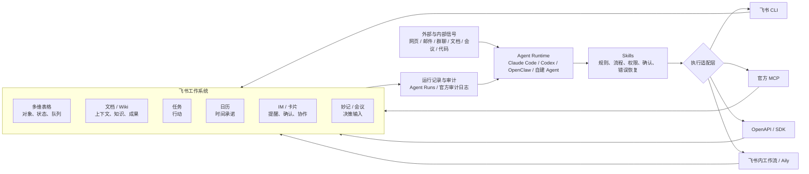
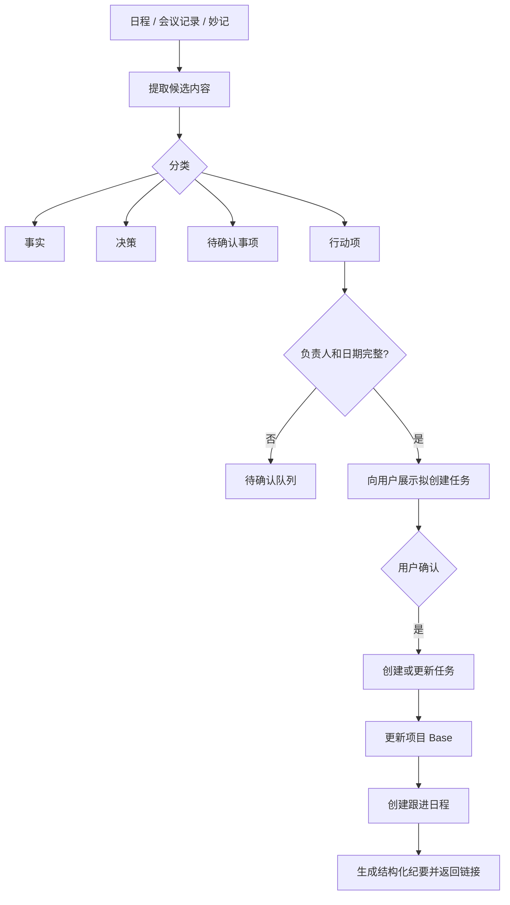

<script setup>
import { MessageSquare, FileText, Calendar, BookOpen, Globe, Layers, ShieldCheck, Route, Bot, ListChecks, Plug, Cloud, Gauge, Rocket, Zap, Database, Cpu, Code, GitBranch, Server, Activity, Brain, Terminal, Workflow, CheckCircle2, Target, TrendingUp, Lock, RefreshCw, FileCode, Network, Boxes, Scale, Timer, Newspaper, Users, FileType, FolderTree, Eye, ClipboardList } from '@lucide/vue'
</script>

<section class="frontpage">
  <p class="frontpage-kicker">飞书 Playbook · 实战手册</p>
  <h1 class="frontpage-title">把飞书接入你和 Agent 的工作系统</h1>
  <p class="frontpage-subtitle">这份手册整理个人开发者和小团队最常用的飞书工作流：每日简报、会议行动、日程安排、项目记忆、内容发布、Coding Agent、事件机器人与混合数据系统。每个场景都给出适用条件、推荐结构、执行步骤和验收标准。</p>
  <div class="frontpage-rule">
    <span><strong>Agent</strong><br>理解意图、规划步骤</span>
    <span><strong>Skill</strong><br>流程、权限、确认、恢复</span>
    <span><strong>飞书</strong><br>上下文、状态、协作</span>
    <span><strong>治理</strong><br>审计、配额、安全</span>
  </div>
</section>

<div class="quick-grid">
  <a href="#_1-飞书在工作系统中的位置"><div class="card-icon"><Globe /></div><div class="card-body"><strong>飞书在工作系统中的位置</strong><span>确定飞书、Agent、Skill、数据库和人的分工。</span></div></a>
  <a href="#_2-工具组合与选择顺序"><div class="card-icon"><Terminal /></div><div class="card-body"><strong>工具组合与选择顺序</strong><span>CLI、MCP、插件、OpenAPI 和多维表格的使用方式。</span></div></a>
  <a href="#_3-场景筛选方法"><div class="card-icon"><Target /></div><div class="card-body"><strong>场景筛选方法</strong><span>六个评分维度、案例优先级地图和推荐顺序。</span></div></a>
  <a href="#_4-个人工作流"><div class="card-icon"><Rocket /></div><div class="card-body"><strong>个人工作流</strong><span>每日简报、会议行动、日程、CRM、项目记忆和发布同步。</span></div></a>
  <a href="#_5-开发者工作流"><div class="card-icon"><Code /></div><div class="card-body"><strong>开发者工作流</strong><span>信号管道、Coding Agent、事件机器人和混合数据架构。</span></div></a>
  <a href="#_6-数据知识与执行系统"><div class="card-icon"><Database /></div><div class="card-body"><strong>数据、知识与执行系统</strong><span>Base、Wiki、任务、日历、卡片、审计与备份。</span></div></a>
  <a href="#_7-skill-工程"><div class="card-icon"><Workflow /></div><div class="card-body"><strong>Skill 工程</strong><span>四种 Skill 类型、SKILL.md 模板、十条规则、Base/文档/事件操作特殊规则。</span></div></a>
  <a href="#_8-参考项目与借鉴重点"><div class="card-icon"><Boxes /></div><div class="card-body"><strong>参考项目与借鉴重点</strong><span>官方底座、社区工作流和真实案例的学习路径。</span></div></a>
  <a href="#_9-稳定运行准则"><div class="card-icon"><ShieldCheck /></div><div class="card-body"><strong>稳定运行准则</strong><span>数据、工作流、安全、可靠性、成本与配额的配置方法。</span></div></a>
  <a href="#_10-十二条设计准则"><div class="card-icon"><CheckCircle2 /></div><div class="card-body"><strong>十二条设计准则</strong><span>把一套系统从原型推进到可长期使用的具体做法。</span></div></a>
  <a href="#_11-运营与治理"><div class="card-icon"><Scale /></div><div class="card-body"><strong>运营与治理</strong><span>权限与身份、配额与成本、安全与提示词注入、指标与复盘。</span></div></a>
  <a href="#_12-30-天落地计划"><div class="card-icon"><Route /></div><div class="card-body"><strong>30 天落地计划</strong><span>从零到可运行系统的四周计划，每周有目标和验收标准。</span></div></a>
</div>

## 1. 飞书在工作系统中的位置 {#_1-飞书在工作系统中的位置}

### <Globe class="cat-icon" /> 这份手册怎么用 {#这份手册怎么用}

飞书的文档、多维表格、知识库、日历、任务、消息、开放平台和 AI 能力已经覆盖了个人与团队的大部分协作环节。真正需要设计的是这些环节怎样连起来：信息从哪里进入，谁负责判断，什么内容进入正式记录，什么动作需要确认，结果怎样回到项目状态。

1. **个人和开发者最值得先做哪些 AI + 飞书场景？**
2. **哪些开源项目和真实案例适合拆解？**
3. **飞书适合承担数据库、知识库、执行系统还是协作界面中的哪一层？**
4. **哪些工作交给 AI，哪些节点保留人工确认？**
5. **怎样把 Skill 写成可靠、可复用的工作流程？**
6. **基础版和开放平台额度怎样配置出可以长期运行的方案？**
7. **怎样设计重复校验、消息确认、权限分层、文档版本和证据链？**

这份 Playbook 给出一套可直接采用的答案：

- 一套 AI-First 飞书的系统模型；
- 一张个人与开发者案例优先级地图；
- 12 个适合优先建设的工作场景；
- 15+ 个值得研究的官方与社区项目；
- 一套多维表格、文档、任务、日历和消息的分工原则；
- 一套可复用的 Skill 工程规范；
- 一套安全、可靠性、成本与配额推荐配置；
- 一条从零到可运行系统的 30 天实施路线。

### <Layers class="cat-icon" /> 飞书适合作为工作操作层 {#工作操作层}

对个人和小团队来说，飞书最适合承接经过整理、需要查看、判断、修改和协作的工作状态：

<div class="play-grid">
  <div class="play-tile"><strong>多维表格</strong><span>对象、状态、关系和队列。项目、客户、信号、任务队列、运行记录。</span></div>
  <div class="play-tile"><strong>文档与知识库</strong><span>上下文、解释、方案、SOP 和最终成果。PRD、研究、纪要、报告、成稿。</span></div>
  <div class="play-tile"><strong>任务</strong><span>明确的行动。有负责人、有状态、有截止日期的行动项。</span></div>
  <div class="play-tile"><strong>日历</strong><span>真实的时间承诺。会议、跟进、深度工作、复查。</span></div>
  <div class="play-tile"><strong>消息与卡片</strong><span>提醒、确认、快速交互。审批式确认、摘要、异常。</span></div>
  <div class="play-tile"><strong>妙记与会议产物</strong><span>决策和行动的输入。逐字稿、摘要、待办、章节。</span></div>
  <div class="play-tile"><strong>CLI、MCP、OpenAPI</strong><span>Agent 的执行通道。200+ 命令，20+ 官方 Skills。</span></div>
  <div class="play-tile"><strong>本地数据库</strong><span>高频原始数据、日志、事务。SQLite、PostgreSQL、对象存储。</span></div>
</div>

大规模原始数据、高频事件、复杂事务和长期历史日志，通常更适合放在 SQLite、PostgreSQL、对象存储或专业数据系统中；飞书承接经过筛选后需要人查看、判断、修改和协作的状态。

这是一条贯穿全文的原则：

> **数据库负责保存世界，多维表格负责让人和 Agent 一起操作世界。**

### <Brain class="cat-icon" /> AI-First 飞书的系统模型 {#系统模型}



### <Layers class="cat-icon" /> 五层职责 {#五层职责}

| 层 | 主要职责 | 推荐配合方式 |
|---|---|---|
| Agent 层 | 理解、规划、提取、归纳、生成 | 通过 Skill 获取边界和执行顺序 |
| Skill 层 | 流程、触发、约束、确认、恢复 | 把可重复的工作写成稳定规则 |
| 执行层 | 调用 CLI、MCP 或 API | 负责真实读写和结构化返回 |
| 飞书层 | 人机协作、状态、知识、动作 | 承接人和 Agent 共同维护的结果 |
| 治理层 | 权限、审计、配额、备份、评估 | 让系统可检查、可恢复、可持续运行 |

### <CheckCircle2 class="cat-icon" /> 可落地场景的四个环节 {#好场景}

适合进入 Playbook 的场景通常拥有一条清晰的工作链：

```text
获取上下文 → 做出结构化判断 → 执行可验证动作 → 把结果写回系统
```

例如会议工作流：

```text
读取会议纪要
→ 识别决策、待确认事项和行动项
→ 确认负责人和截止日期
→ 创建任务
→ 更新项目状态
→ 安排复查日程
→ 返回所有结果链接
```

### <Users class="cat-icon" /> Agent、Skill 和飞书各自承担不同职责 {#职责分工}

- **Agent**：理解意图、规划步骤、处理模糊信息；
- **Skill**：规定触发条件、读取范围、执行步骤、确认节点和恢复方式；
- **CLI / MCP / OpenAPI**：执行真实操作；
- **飞书**：承载上下文、状态、协作关系和结果；
- **人**：处理价值判断、冲突、外部沟通和高确认级别动作。

飞书官方 CLI 当前覆盖消息、文档、云盘、多维表格、日历、任务、邮箱、会议等核心业务域，并在仓库中列出 200+ 命令和 20+ Agent Skills；其中还包括 `lark-skill-maker`、会议纪要汇总和日程待办摘要等工作流 Skill。[^official-cli]

### <Target class="cat-icon" /> 推荐建设顺序 {#优先顺序}

对个人和开发者，推荐优先顺序是：

1. 每日工作简报；
2. 会议到行动；
3. 日程安排助手；
4. Markdown 发布与备份；
5. 个人 CRM；
6. 项目记忆与带引用问答；
7. 行业信号与内容管道；
8. Coding Agent 飞书入口；
9. 多 Agent 团队；
10. 轻量业务系统。

前三项频率高、边界清楚、反馈快，适合建立第一轮使用习惯。

### <ShieldCheck class="cat-icon" /> "读—计划—确认—写—验证—报告"默认合同 {#默认合同}

所有写操作应遵循：

```text
Read      读取真实资源、结构、权限和当前状态
Plan      给出拟执行步骤和影响范围
Confirm   对中高确认级别动作取得明确确认
Write     执行最小必要写入
Verify    重新读取，确认结果真的落地
Report    返回链接、ID、变更摘要和待处理事项
```

这套顺序适合成为个人和团队 Skill 的统一执行协议。

### <Gauge class="cat-icon" /> 基础版的推荐配置 {#免费版边界}

截至本文快照日期（2026-07-12），基础版支持 100 名用户；云文档存储为认证前 15 GB、认证后 100 GB；多维表格基础权益通常以单表 2,000 行展示；基础版自动化与工作流共享每月 200 次运行额度；基础免费版企业自建应用 API 调用总量为每月 10,000 次。AI 额度按具体产品、租户和权益动态变化，统一数字以后台信息为准。[^pricing][^storage][^base-entitlement][^api-quota][^ai-quota]

基础版适合：

- 低频但高价值的工作流；
- 人工与 AI 共同维护的状态表；
- 经过筛选的知识和信号；
- 每日、每周、会后等周期性流程；
- 小规模 CRM、项目管理和内容系统。

高频原始数据采用“数据库保存原始记录，飞书同步候选和结果”的组合；网页全文、聊天日志和模型中间结果按照数据量配置外部存储。

### <Globe class="cat-icon" /> 飞书和同类工具的区别 {#飞书-vs-同类}

| 工具 | 核心定位 | 推荐使用方式 |
| --- | --- | --- |
| 飞书 | 一体化协作平台 + 工作操作层 | IM、文档、流程、状态和 Agent 协作 |
| 钉钉 | 企业数字化平台 | 考勤、审批和 ERP 对接 |
| 企微 | 客户连接工具 | 销售、客服和私域运营 |
| Notion | 知识库与文档 | 个人知识管理和项目管理 |
| Slack | 即时通讯 | 以 IM 为中心的协作 |
| Teams | Office 生态协作 | 深度使用 Microsoft 365 的组织 |
| Lark（国际版） | 飞书海外版 | 跨境团队与国际协作 |

选择标准：如果你的团队既需要即时通讯，又需要文档协作、项目管理、审批流程，且希望它们与 Agent 深度联动，飞书是最合适的选择。

## 2. 工具组合与选择顺序 {#_2-工具组合与选择顺序}

### <Terminal class="cat-icon" /> 决策表 {#工具决策表}

| 方案 | 适合场景 | 优点 | 配套条件 |
|---|---|---|---|
| 官方飞书 CLI | 个人开发者、Coding Agent、快速原型 | 覆盖广、结构化输出、内置 Skills | 配置本地运行环境和授权 |
| 官方 OpenAPI MCP | 原生支持 MCP 的客户端 | 工具发现自然、接入标准化 | 按 Beta 版本持续核对能力[^official-mcp] |
| 官方 OpenClaw 插件 | 已使用 OpenClaw 的飞书聊天工作流 | 消息、文档、Base、日历、任务一体化 | 配置 OpenClaw 运行时[^official-openclaw] |
| OpenAPI / SDK | 稳定服务、高频集成、后台系统 | 适合队列、重试、监控和服务化 | 配置服务化运行环境 |
| 多维表格工作流 / Aily | 流程主要发生在飞书内部 | 业务用户易维护，贴近数据 | 按额度和产品边界设计流程 |
| 社区 MCP / CLI | 官方能力之外的细分工作流 | 某些能力更细，贴近具体场景 | 做权限、维护状态和兼容性审查 |

### <Terminal class="cat-icon" /> 对个人开发者的默认建议 {#默认建议}

```text
第一选择：官方 CLI + 官方 Skills
第二选择：针对缺口补官方 MCP 或社区工具
需要长期服务化时：迁移到 OpenAPI / SDK
已使用 OpenClaw：优先官方插件
高频采集：本地数据库 + 批量同步飞书
```

飞书官方 `lark-skill-maker` 给出的调用优先级是：**Shortcut > 已注册 API > 裸 OpenAPI**；它同时要求 Skill 写清权限、写操作确认、`dry-run` 预览、步骤间数据传递、恢复路径和可并行步骤。[^skill-maker]

### <Plug class="cat-icon" /> 飞书各模块的正确分工 {#模块分工}

| 模块 | 最适合回答的问题 | 典型内容 |
|---|---|---|
| 多维表格 | 有哪些对象？当前处于什么状态？ | 项目、客户、信号、任务队列、运行记录 |
| 文档 | 为什么？具体内容是什么？ | PRD、研究、SOP、纪要、报告、成稿 |
| 知识库 | 哪些内容是正式、可长期引用的知识？ | 项目 Wiki、领域知识、Playbook |
| 任务 | 下一步明确要完成什么？ | 有负责人、有状态的行动项 |
| 日历 | 什么时候真的投入时间？ | 会议、跟进、深度工作、复查 |
| 消息与卡片 | 什么现在必须被看到或确认？ | 提醒、审批式确认、摘要、异常 |
| 妙记 | 会上说了什么，产生了什么候选结论？ | 逐字稿、摘要、待办、章节 |
| 本地数据库 | 哪些数据量大、频率高、需要事务？ | 抓取结果、日志、原始事件、模型缓存 |

### <Server class="cat-icon" /> 官方 CLI 快速开始 {#cli-快速开始}

```bash
# 安装
npx @larksuite/cli@latest install

# 初始化配置（创建新应用或绑定已有应用）
lark-cli config init --new

# 登录授权（推荐 user 身份）
lark-cli auth login --recommend

# 检查认证状态与 scope
lark-cli auth status

# 查看所有可用命令
lark-cli --help

# 查看某个业务域命令
lark-cli calendar --help
lark-cli task --help
lark-cli base --help
```

CLI 命令会随版本更新，正式项目以官方仓库和当前 `--help` 输出为准。[^official-cli]

### <Cpu class="cat-icon" /> 飞书 API 的核心概念 {#api-核心概念}

| 概念 | 说明 | 注意事项 |
|---|---|---|
| tenant_access_token | 应用级别的访问令牌 | 有效期 2 小时，需缓存和刷新 |
| user_access_token | 用户级别的访问令牌 | 代表用户操作，权限受用户授权范围限制 |
| app_access_token | 应用访问租户的令牌 | 用于获取 tenant_access_token |
| API 限流 | 不同接口有不同的 QPS 限制 | 要处理 429，尊重 retry-after |
| scope | 权限范围 | 按实际工作流申请最小集合 |
| 事件订阅 | 监听飞书事件 | 事件优于轮询，需要验证和去重 |

## 3. 场景筛选方法 {#_3-场景筛选方法}

### <Target class="cat-icon" /> 六个评分维度 {#评分维度}

每个候选场景按 1—5 分评估：

| 维度 | 高分意味着 |
|---|---|
| 频率 | 每天或每周反复发生 |
| 上下文碎片度 | 信息散在多个模块和来源 |
| 结构化程度 | 输入与结果可形成稳定字段 |
| 可执行性 | 结果可以创建任务、更新状态或安排时间 |
| 可验证性 | 写入后能通过 ID、链接和状态检查 |
| 确认可控性 | 可以预览、确认、回滚或限制范围 |

一个好场景通常具备：

```text
高频 + 上下文分散 + 结果结构化 + 动作可验证 + 确认路径清楚
```

### <TrendingUp class="cat-icon" /> 案例优先级地图 {#案例优先级地图}

| 场景 | 个人价值 | 实现复杂度 | 确认级别 | 免费版适配 | 建议 |
|---|---:|---:|---:|---:|---|
| 每日工作简报 | 5 | 1 | 1 | 5 | 第一个做 |
| 会议到行动 | 5 | 3 | 3 | 5 | 第二个做 |
| 日程安排助手 | 4 | 2 | 3 | 5 | 尽早做 |
| Markdown 发布与备份 | 4 | 3 | 2 | 5 | 开发者优先 |
| 个人 CRM | 4 | 3 | 3 | 4 | 有稳定沟通量后做 |
| 项目记忆与引用问答 | 5 | 4 | 2 | 4 | 知识工作者优先 |
| 行业信号与内容管道 | 5 | 4 | 2 | 3 | 先控制数据量 |
| Coding Agent 飞书入口 | 5 | 4 | 5 | 3 | 工程师进阶 |
| 多 Agent 机器人团队 | 4 | 5 | 4 | 2 | 完成单 Agent 后扩展 |
| 轻量业务系统 | 5 | 5 | 4 | 2 | 验证后再扩展 |

## 4. 个人工作流 {#_4-个人工作流}

### <Gauge class="cat-icon" /> 场景一：每日工作简报 {#每日工作简报}

#### 适用场景

每天开始工作时，信息通常分散在：

- 日历里的会议；
- 任务里的待办；
- 多维表格里的项目状态；
- 邮件和群聊里的临时承诺；
- 昨天延续到今天的事项。

普通"早报"容易变成信息堆砌。真正有价值的简报应该回答：

1. 今天有哪些固定时间承诺？
2. 哪些任务今天到期或已经逾期？
3. 哪些会议存在冲突？
4. 哪个项目需要补充下一步行动？
5. 今天最值得完成的三件事是什么？

#### 最小可用流程

```text
读取今日日程
+ 读取未完成任务
→ 按时间和截止日期排序
→ 检测冲突与逾期
→ 输出 3 个优先行动
→ 发送到个人聊天或生成卡片
```

官方仓库中的 `lark-workflow-standup-report` 已经展示了一个很好的基础模式：并行读取日程与未完成任务，显式过滤已完成任务，再由 AI 完成时间转换、冲突检测和摘要。[^standup-skill]

#### CLI 调用示例

```bash
# 读取今日日程
lark-cli calendar list --start "$(date -d 'today 00:00' +%s)" \
  --end "$(date -d 'today 23:59' +%s)" --format json

# 读取未完成任务
lark-cli task list --status incomplete --format json

# 发送简报到个人聊天
lark-cli message send --user self --text "今日简报已生成" --card card.json
```

#### 推荐输出

```markdown
## 今日工作简报

### 时间承诺
- 10:00–11:00 产品评审
- 15:00–16:00 客户同步

### 优先处理
- [逾期] 提交报价方案
- [今天到期] 确认发布清单

### 需要安排
- 15:00 的会议与深度工作块冲突
- 项目 Alpha 已 7 天需要补充下一步行动

### 建议
1. 09:00–09:45 完成报价方案
2. 评审后立即确认 Alpha 的负责人
3. 17:30 做 10 分钟收尾复盘
```

#### 推荐配置

- 聚焦需要决策或行动的信息；
- 任务读取明确使用"未完成"状态；
- 历史任务折叠到次级区域；
- 只在用户授权的日期范围内读取；
- 简报可以自动生成，日程变更保留确认节点；
- 把"信息摘要"和"行动建议"分开。

#### 进阶玩法

- **周报模式**：汇总一周的完成情况、逾期情况和项目健康度；
- **个人 OKR 追踪**：把简报关联到 OKR 进度，每天提醒关键结果；
- **能量管理**：根据日程密度建议深度工作块；
- **多日历合并**：合并个人日历、工作日历和订阅日历；
- **简报卡片化**：用交互式卡片让用户一键确认或推迟行动。

#### 验收指标

- 每天规划所需时间；
- 被提前发现的日程冲突数；
- 逾期任务比例；
- 简报建议被采纳的比例；
- 有明确下一步行动的活跃项目数量。

### <FileText class="cat-icon" /> 场景二：会议到行动 {#会议到行动}

#### 适用场景

很多会议已经有录音、转写和 AI 摘要，下一步是把其中的决策、待确认事项和行动转成可追踪记录：

- "讨论了"被误写成"决定了"；
- 待办需要补充负责人；
- 负责人需要补充截止日期；
- 相同待办被重复创建；
- 任务创建后同步回项目状态；
- 下次会议仍然从头讨论。

#### 推荐流程



社区项目 `lark-workflow-feishu-cli` 给出了"从妙记提取待办—通过消息确认—创建任务—持续检查"的完整示例，适合作为实现参考。[^workflow-pack]

#### 业务规则

- 只有明确承诺的内容才标为"决策"；
- 负责人和截止日期从原始资料或人工确认中获得；
- 缺失字段进入"待确认"队列；
- 创建任务前先按会议 ID、文本摘要和负责人检查重复；
- 同一个会议重复运行时应更新已有记录；
- 会议摘要作为候选输入，关键结论保留原文或时间戳链接。

#### 推荐幂等键

```text
meeting_id + normalized_action_text + owner_id
```

或者：

```text
source_type + source_id + action_hash
```

#### 确认等级

| 动作 | 确认级别 | 默认策略 |
|---|---|---|
| 读取妙记 | 低 | 可直接执行 |
| 生成候选行动项 | 低 | 可直接执行 |
| 创建个人任务 | 中 | 展示后确认或执行后报告 |
| 给他人分配任务 | 高 | 必须确认 |
| 发送会议总结 | 高 | 必须确认收件范围 |
| 创建外部参与者日程 | 高 | 必须确认 |

#### 验收指标

- 会议结束到任务创建的时间；
- 有负责人和截止日期的行动项比例；
- 重复任务率；
- 下一次会议重复讨论同一问题的比例；
- 逾期行动项比例。

### <Calendar class="cat-icon" /> 场景三：日程安排助手 {#日程安排助手}

#### 适用场景

安排会议需要同时处理联系人、多人忙闲、时区、工作时间、会议缓冲、会议室、外部参与者和会议材料：

- 联系人身份解析；
- 多人忙闲；
- 时区；
- 工作时间；
- 会议缓冲；
- 会议室；
- 外部参与者；
- 是否需要附加材料；
- 是否需要发送消息。

#### 推荐流程

```text
识别参会人
→ 读取目标日期与时区
→ 查询忙闲
→ 应用工作时间、缓冲和时长规则
→ 返回 2—3 个候选
→ 用户选择
→ 创建日程
→ 附加会议材料
→ 验证参会人和时间
→ 返回链接
```

`Feishu-CLI-Web` 的示例很好地展示了"搜索联系人—查询共同空闲—创建会议—邀请参会人—发送链接"，并且在真正写入之前展示执行计划和要求确认。[^cli-web]

#### 推荐配置

- 所有时间都转换成绝对日期、时间和时区；
- 联系人使用真实 ID，多候选时完成消歧；
- 默认避开工作时间边界和连续会议；
- 邀请接受保留用户操作；
- 对外部参与者、会议室和消息发送必须确认；
- 创建后重新读取日程，验证时间、参会人和 RSVP；
- "任务截止日"与"日历时间块"分开管理。

#### 一个推荐的个人规则集

```yaml
working_hours:
  monday_friday: "09:30-18:30"
  weekend: off
meeting_buffer_minutes: 15
default_meeting_duration_minutes: 45
deep_work_blocks:
  - "09:30-11:30"
  - "14:00-16:00"
external_invite_requires_confirmation: true
same_day_meeting_requires_confirmation: true
max_meetings_per_day: 6
lunch_protect: true
timezone: Asia/Shanghai
```

#### 验收指标

- 安排一次会议所需的往返沟通次数；
- 自动发现的时间冲突数；
- 被拒绝的会议邀请比例；
- 会议密度（每天会议总时长）。

### <Users class="cat-icon" /> 场景四：个人 CRM {#个人-crm}

#### 适用场景

个人 CRM 用来回答：

- 我最近和谁有过有意义的互动？
- 哪些重要关系需要安排下一次跟进？
- 上次谈到了什么？
- 我答应了什么？
- 下一步应该在什么时候联系？
- 关系判断依据是什么？

#### 推荐数据模型

##### Contacts

| 字段 | 类型 | 说明 |
|---|---|---|
| contact_id | 文本 | 稳定主键 |
| 姓名 | 文本 | 显示名称 |
| 公司 / 组织 | 文本 | 所属机构 |
| 角色 | 单选 | 决策者、合作伙伴、朋友等 |
| 重要程度 | 单选 | 人工设定：高、中、低 |
| 最后互动时间 | 日期 | 从互动表聚合 |
| 下一次跟进 | 日期 | 计划时间 |
| 关系健康度 | 公式 | 启发式评分，展示计算规则 |
| 备注文档 | URL / 关联 | 关联文档 |
| 状态 | 单选 | 活跃、低频、暂停、归档 |
| source_id | 文本 | 飞书用户 ID 或外部 ID |

##### Interactions

| 字段 | 类型 | 说明 |
|---|---|---|
| interaction_id | 文本 | 稳定主键 |
| contact_id | 关联 | 关联联系人 |
| 时间 | 日期时间 | 互动发生时间 |
| 类型 | 单选 | 邮件、会议、消息、线下 |
| 摘要 | 长文本 | AI 提取后的摘要 |
| 来源链接 | URL | 可追溯证据 |
| 承诺事项 | 长文本 | 双方承诺 |
| 是否需跟进 | 复选框 | 布尔值 |
| source_id | 文本 | 原始事件 ID |
| evidence_status | 单选 | 未验证、部分验证、已验证 |

#### 推荐流程

```text
增量读取授权范围内的邮件、日历或消息
→ 过滤广告和系统通知
→ 识别联系人与互动
→ 写入 Interaction
→ 更新最后互动时间
→ 计算关系健康度
→ 生成待跟进候选
→ 用户确认后创建任务或日程
```

`lark-workflow-feishu-cli` 中的个人 CRM 示例包含联系人表、互动记录表、关系热度和超期提醒，是很好的场景起点。[^workflow-pack]

#### 推荐配置

- 采用增量同步建立数据窗口；
- 重要程度支持人工覆盖；
- "关系健康度"应显示计算规则；
- 关系健康度结合人工判断和计算规则；
- 发送消息、邮件或邀请前必须确认；
- 对敏感联系人使用独立视图和更严格权限；
- 为联系人提供"暂停跟进"状态。

#### 免费版适配

个人 CRM 通常很适合免费版。真正容易增长的是互动记录表，因此应：

- 保存摘要与来源，邮件全文按需归档到外部数据库；
- 每季度归档低价值互动；
- 对高频历史使用外部数据库，Base 只保留最近窗口和汇总。

### <BookOpen class="cat-icon" /> 场景五：项目记忆与带引用问答 {#项目记忆}

#### 适用场景

项目资料分布在文档、群聊、会议、PDF 和临时消息中，团队需要一套带来源的项目 Wiki：

- 标记最新版和正式版本；
- 为结论保存来源；
- 把不同资料的差异进入待确认队列；
- 为新人提供项目入口；
- 把 AI 推断单独标记。

社区项目 `document-buddy` 提出了项目 Wiki、证据引用、资料差异和待确认队列的组合方法。[^document-buddy]

#### 推荐 Wiki 结构

```text
项目名称/
├── 00 项目总览
├── 10 目标与范围
├── 20 需求
├── 30 决策记录
├── 40 待处理事项
├── 50 承诺与行动
├── 60 人物与协作关系
├── 70 会议与沟通
├── 80 来源清单
└── 90 待确认问题
```

#### 证据规则

- 结论带来源；
- 推断标为"推断"；
- 冲突信息并列展示；
- 重要结论保存原始文档链接、消息链接或会议时间戳；
- 正式 Wiki 与"待整理收件箱"分开；
- 更新已有结论时保留变更原因和来源。

#### 推荐问答输出

```markdown
## 回答

当前确认的客户预算是 **10–12 万元区间**，资料仍在等待最终审批口径。

### 已确认
- 采购负责人在 6 月 18 日会议中表示预算上限接近 12 万元。[来源]
- 早期需求文档仍记录为 10 万元。[来源]

### 待确认
- 最终预算是否已经在 6 月 18 日之后完成审批。

### 建议下一步
- 在下次客户会议中明确预算口径，并更新《项目总览》和《决策记录》。
```

#### 最适合的用户

- 咨询顾问；
- 产品经理；
- 客户成功；
- 研究人员；
- 多项目并行的独立开发者；
- 经常需要交接项目的团队。

### <FileType class="cat-icon" /> 场景六：Markdown 发布、同步与备份 {#markdown-发布}

#### 适用场景

开发者同时维护本地 Markdown、Git 仓库和飞书文档，需要稳定的发布、同步、映射和备份记录：

- 本地版本和飞书版本保持映射；
- 图片与附件拥有独立处理方式；
- 文档创建前查询映射；
- 更新时保留 revision；
- 知识库定期导出备份；
- 文档记录版本和映射关系。

飞书官方案例展示了用 Agent 把本地 Markdown 创建为飞书文档并归档到知识库；社区的 `feishu-docx` 支持文档、Wiki、Sheet 和 Base 导出到 Markdown，也支持创建、追加和更新指定 Block；`asknow` 中的 `feishu-sync` Skill 则展示了本地知识库到飞书 Wiki 或云文档的增量同步设计。[^doc-publish][^feishu-docx][^asknow-sync]

#### 先确定"唯一主源"

| 模式 | 主源 | 适合 |
|---|---|---|
| Local-first | Git / Markdown | 开发者、版本控制、自动发布 |
| Feishu-first | 飞书 Wiki / Docs | 团队协作、非技术编辑 |
| One-way mirror | 一侧主源，另一侧只读镜像 | 备份与发布 |

双向同步配套主源、revision、hash、冲突状态和人工确认。

#### 推荐映射文件

```yaml
documents:
  - local_path: "playbook/index.md"
    feishu_type: "wiki"
    feishu_token: "wikcn_xxx"
    last_synced_hash: "sha256:..."
    last_synced_revision: "..."
    sync_direction: "local_to_feishu"
    conflict_policy: "stop_and_ask"
  - local_path: "docs/architecture.md"
    feishu_type: "doc"
    feishu_token: "doxcn_xxx"
    last_synced_hash: "sha256:..."
    sync_direction: "bidirectional"
    conflict_policy: "feishu_wins"
```

#### 更新规则

- 创建前查询映射，保持文档唯一；
- 更新前比较本地哈希和远端 revision；
- 两侧都修改时停止并提示冲突；
- 局部编辑优先，整篇覆盖保留确认；
- 图片、附件和内部链接单独处理；
- 每次同步记录文档 ID、版本和结果；
- 删除操作默认禁用；
- 备份应保留目录结构和相对链接。

#### 推荐产物

- 本地 Markdown；
- 飞书 Wiki 正式页面；
- `FEISHU_MAP.yml`；
- 同步日志；
- 每周自动导出的备份包；
- Git commit 或版本标签。

## 5. 开发者工作流 {#_5-开发者工作流}

### <Newspaper class="cat-icon" /> 场景七：行业信号与内容生产管道 {#行业信号}

#### 适用场景

AI 可以抓取很多信息，稳定的信号管道需要同时保留事件键、来源层级、证据状态和选题记录：

- 同一事件通过内容指纹合并；
- 官方事实与媒体转述分层保存；
- 热度与真实性分别记录；
- 选题判断保留来源和理由；
- 成稿关联原始证据；
- 每轮运行保存成本和结果。

飞书官方分享的热点追踪实践提出了一个非常值得复用的结构：Agent 抓取和初步整理，CLI 负责写入，多维表格承接证据、状态和人工判断，IM 推送重点候选，后续 AI 基于历史记录辅助选题与写作。[^hotspot-case]

#### 推荐信源分层

| 层级 | 作用 | 示例 |
|---|---|---|
| S0 官方事实源 | 证明事件真实发生 | 官网、官方博客、Release、公告 |
| S1 官方扩散源 | 捕捉官方传播与用户追问 | 官方社媒、公众号 |
| S2 社区验证源 | 验证采用、问题和真实需求 | GitHub、HN、Reddit、论坛 |
| S3 媒体与内容源 | 识别二次扩散和内容机会 | 媒体、KOL、教程、视频 |

#### 推荐表结构

1. **Sources**：信源、类型、抓取方式、健康状态、最后抓取时间；
2. **Raw Signals**：每条原始证据，包含 URL、标题、摘要、来源层级、时间戳、内容指纹；
3. **Events**：合并后的事件，关联多条 Signal，有事件键；
4. **Topics**：选题、角度、受众、状态、关联事件；
5. **Runs**：每轮抓取、错误和成本；
6. **Content**：文章、长帖、脚本和发布结果。

#### 推荐流程

```text
采集
→ 标准化 URL 和时间
→ 内容指纹去重
→ 按事件聚类
→ 寻找 S0 事实源
→ 计算证据状态
→ 人工复核
→ 进入选题池
→ AI 生成角度和大纲
→ 文档协作
→ 发布与复盘
```

#### 关键架构选择

推荐把原始抓取结果放入数据库，再把候选和证据摘要同步到 Base：

```text
抓取器 / RSS / API
→ SQLite / PostgreSQL 保存原始数据
→ 规则过滤与去重
→ 把候选事件和证据摘要同步到 Base
→ 人在飞书里判断
```

这种模式可以控制 API 调用，并让 Base 保持适合协作的规模。

#### 验收指标

- 有 S0 来源的事件比例；
- 重复事件率；
- 候选到选题的转化率；
- 选题到成稿的转化率；
- 每篇内容可追溯来源数；
- 被撤回或更正的事实数；
- 每个有效选题消耗的 API 调用和模型成本。

### <Code class="cat-icon" /> 场景八：把 Coding Agent 接回飞书 {#coding-agent}

#### 适用场景

Coding Agent 需要连接飞书聊天、项目状态和本地执行环境：

- 产品需求在群里，执行发生在项目工作区；
- 移动端可以继续会话；
- 多个项目和 session 按群与话题管理；
- 结果自动整理成文档或 PR 摘要；
- 团队可以看到 Agent 当前状态；
- 工具调用拥有交互确认。

`Lark Coding Agent Bridge` 把飞书消息桥接到本地 Claude Code 或 Codex，支持流式卡片、每个聊天或话题独立 session、队列、工作区切换以及图片和文件输入。飞书官方也发布了对应实践文章。[^coding-bridge][^coding-bridge-case]

#### 推荐会话模型

```text
一个群 = 一个项目
一个话题 / Thread = 一个独立工作会话
一个文档评论线程 = 一个具体审阅任务
```

#### 推荐协作流程

```text
群里提出需求
→ Agent 生成计划卡片
→ 人确认范围
→ Agent 在受限工作区执行
→ 流式报告进度
→ 生成飞书文档或 PR 摘要
→ 人进行最终合并或发布
```

#### 配套安全配置

- 群和用户白名单；
- 工作目录白名单；
- `.env`、密钥目录和项目目录分层；
- Shell 命令按确认级别分类；
- 删除、发布、推送、部署必须确认；
- 生产环境凭证与 Agent 环境隔离；
- 每个群绑定明确项目；
- 会话过期与手动 `/new`；
- 记录所有工具调用；
- 复杂任务在沙箱中运行。

#### 工作区配置

- 群成员按白名单触发 Shell；
- 飞书权限和基础设施权限按 Agent 职责分层；
- 群内展示进度、结果和必要摘要；
- 部署动作通过计划预览和确认执行；
- 项目状态同步到 Base、Git 或文档。

### <Zap class="cat-icon" /> 场景九：事件驱动机器人 {#事件驱动机器人}

#### 适用场景

事件机器人适合比定时简报更实时、比完整 Coding Agent 更轻量的工作：

- 新妙记生成后自动进入处理队列；
- 多维表格状态变化后通知下游；
- 收到特定群消息后创建收件箱记录；
- 审批状态变更后触发后续流程；
- 新成员加入后发送欢迎消息。

飞书事件订阅 + Agent 子进程的组合，可以做出比轮询更高效、比工作流更灵活的事件驱动系统。

#### 推荐架构

```text
飞书事件订阅
→ 事件消费者（Agent 子进程）
→ 事件 schema 校验
→ 按 EventKey 路由到对应 Skill
→ 执行业务逻辑
→ 写回飞书
→ 记录 Agent Run
```

#### 官方 `lark-event` Skill 的关键规则 {#event-skill-规则}

- 先读取事件 schema，再写过滤规则；
- 使用结构化错误类型；
- 用 ready marker 判断消费者真正就绪；
- 开发和测试时使用 `--max-events` 或 `--timeout`；
- 用 SIGTERM 或关闭 stdin 优雅退出；
- 使用 SIGTERM 或关闭 stdin 优雅退出；
- 一个消费者处理一种 EventKey，便于隔离运行状态。[^event-skill]

#### 一个事件消费者的最小骨架

```bash
# 启动事件消费者
lark-cli event consume \
  --event-key "im.message.receive_v1" \
  --handler "skills/inbox-handler/SKILL.md" \
  --max-events 100 \
  --timeout 3600

# 优雅退出：发送 SIGTERM
kill -TERM $PID
```

#### 验收指标

- 事件到达到处理完成的时间；
- 事件丢失率；
- 重复处理率；
- 消费者重启次数；
- 队列积压长度。

### <Database class="cat-icon" /> 场景十：本地数据库 + Base 看板 {#本地数据库-base-看板}

#### 适用场景

有些业务的数据量、事务需求和查询复杂度，超出多维表格的承载能力，但团队又需要飞书的协作和移动查看能力。

#### 推荐混合架构

```text
本地数据库（SQLite / PostgreSQL）
→ 保存高频原始数据
→ 规则过滤与去重
→ 批量同步候选结果到 Base
→ 飞书作为移动看板和协作界面
→ 人工判断和决策在飞书完成
→ 决策结果回写数据库
```

`Auto-JobHunter` 用 SQLite 保存和处理高频数据，飞书多维表格作为移动端岗位看板；`mealoptima` 让 Base 承载业务数据和协作，通过自动化触发外部 AI 服务，再把结果回写。[^auto-job][^mealoptima]

#### 什么时候用数据库，什么时候用 Base

| 条件 | 推荐 |
|---|---|
| 每天新增超过数百条 | 数据库 |
| 需要事务 | 数据库 |
| 需要复杂 JOIN | 数据库 |
| 需要全文索引 | 数据库 |
| 需要长期保存每次模型中间结果 | 数据库 |
| 需要高频写入 | 数据库 |
| 需要严格的数据保留策略 | 数据库 |
| 需要人查看和协作 | Base |
| 需要移动端访问 | Base |
| 需要状态机和视图 | Base |
| 需要团队共同维护 | Base |

#### 同步策略

- **单向同步**：数据库 → Base，定时批量推送候选结果；
- **双向同步**：需要冲突策略，复杂度高，谨慎使用；
- **增量游标**：用 `updated_at` 或 `cursor` 字段做增量；
- **批量写入**：用 Base 的批量创建 API 减少调用次数；
- **归档策略**：定期把旧数据从 Base 归档到数据库。

### <Network class="cat-icon" /> 场景十一：多用户 Agent 工作台 {#多用户-agent-工作台}

#### 适用场景

当 Agent 从个人工具扩展到团队工具时，团队工作台需要统一入口和分层授权：

- 成员拥有各自权限；
- 需要执行记录和审计；
- 需要场景模板沉淀团队流程；
- 需要计划预览和写操作确认；
- 需要多用户隔离。

`Feishu-CLI-Web` 展示了关键能力：先显示执行计划、写操作要求确认、每个用户使用独立授权和 HOME、保存对话与执行记录、用场景模板沉淀团队流程。[^cli-web]

#### 推荐架构

```text
飞书聊天 / Web 界面
→ 用户身份解析
→ 权限检查
→ 场景模板选择
→ Agent 生成执行计划
→ 用户确认
→ 在隔离 HOME 中执行
→ 写回飞书
→ 保存执行记录
→ 审计日志
```

#### 团队部署前必须完成

- 完整安全审计；
- 每个用户的权限范围；
- 场景模板的白名单；
- 执行记录的保留策略；
- 待处理运行的告警机制；
- 紧急停用方案。

### <Bot class="cat-icon" /> 场景十二：多 Agent 分工 {#多-agent-分工}

#### 适用场景

一个 Agent 做所有事，权限过大、上下文过长、难以测试。更好的方式是让多个 Agent 各自负责一个领域。

#### 推荐分工模型

| Agent | 职责 | 权限范围 |
|---|---|---|
| 简报 Agent | 读取日历和任务，生成简报 | 只读日历和任务 |
| 会议 Agent | 处理妙记，提取行动项 | 读取妙记，创建任务 |
| 日程 Agent | 安排会议，管理日历 | 读写日历 |
| CRM Agent | 维护联系人，提醒跟进 | 读写 CRM 表 |
| 信号 Agent | 抓取和筛选信号 | 读写信号表 |
| 内容 Agent | 辅助选题和写作 | 读写内容表和文档 |

`awesome-lark-bots` 项目展示了多 Agent 分工和低权限聊天入口的探索。[^awesome-bots]

#### 协调原则

- 每个 Agent 只有一个核心职责；
- Agent 之间通过 Base 或消息传递协作；
- 每个 Agent 有独立权限和凭证；
- 运行彼此隔离，一个 Agent 的状态单独记录；
- 统一的 Agent Runs 记录所有运行。

## 6. 数据、知识与执行系统 {#_6-数据知识与执行系统}

### <Database class="cat-icon" /> 建议的最小个人工作系统 {#最小工作系统}

为了让第一版结构易于维护，建议先建立一个 Base，包含四张核心表。

#### Projects

| 字段 | 类型 | 说明 |
|---|---|---|
| project_id | 文本 | 稳定的业务主键 |
| 项目名称 | 文本 | 人类可读名称 |
| 状态 | 单选 | 规划中、进行中、阻塞、完成、归档 |
| 目标 | 长文本 | 成功标准 |
| 下一步行动 | 文本 | 写成具体动作 |
| 负责人 | 人员 | 个人系统可为自己 |
| 截止日期 | 日期 | 项目承诺 |
| 健康状态 | 单选 | 绿、黄、红 |
| 相关文档 | URL / 关联 | 项目 Wiki |
| 最近活动时间 | 日期 | 由事件或人工更新 |
| source_of_truth | 单选 | Base、Git、外部系统 |

#### Actions

| 字段 | 类型 | 说明 |
|---|---|---|
| action_id | 文本 | 稳定主键 |
| 标题 | 文本 | 可执行动作 |
| 所属项目 | 关联 | 关联 Projects |
| 负责人 | 人员 | 必填 |
| 截止日期 | 日期 | 按需填写，缺失时进入待确认 |
| 状态 | 单选 | 候选、已确认、进行中、完成、取消 |
| 来源类型 | 单选 | 会议、消息、文档、人工 |
| source_id | 文本 | 原始对象 ID |
| dedup_key | 文本 | 幂等键 |
| 飞书任务 ID | 文本 | 创建后写回 |
| 日历事件 ID | 文本 | 排期后写回 |
| 验证状态 | 单选 | 待验证、已验证、待处理 |

#### Signals

| 字段 | 类型 | 说明 |
|---|---|---|
| signal_id | 文本 | 稳定主键 |
| 标题 | 文本 | 信号标题 |
| 来源 URL | URL | 原始证据 |
| 来源层级 | 单选 | S0、S1、S2、S3 |
| 事件键 | 文本 | 聚合同一事件 |
| 摘要 | 长文本 | 结构化摘要 |
| 证据状态 | 单选 | 未验证、部分验证、已验证、冲突 |
| 相关性 | 数字 | 业务相关性 |
| 状态 | 单选 | 收件箱、复核、候选、采用、归档 |
| 相关项目 / 选题 | 关联 | 下游用途 |

#### Agent Runs

| 字段 | 类型 | 说明 |
|---|---|---|
| run_id | 文本 | 每次运行唯一 ID |
| skill_name | 文本 | Skill 名称与版本 |
| trigger | 文本 | 人工、定时、事件 |
| actor | 文本 | 用户身份或应用身份 |
| input_summary | 长文本 | 输入摘要，保存必要信息 |
| read_set | 长文本 | 读取对象与范围 |
| planned_writes | 长文本 | 拟写入内容 |
| actual_writes | 长文本 | 实际变更与对象 ID |
| status | 单选 | 成功、部分完成、待处理、取消 |
| error_type | 文本 | 结构化错误 |
| api_call_estimate | 数字 | 估算调用量 |
| started_at / ended_at | 日期时间 | 运行区间 |
| needs_review | 复选框 | 是否需人工复核 |

### <Eye class="cat-icon" /> 推荐视图 {#推荐视图}

- **Today**：今天到期、逾期和已排期行动；
- **Needs Confirmation**：负责人、日期、目标资源待补充的候选；
- **Needs Update Projects**：超过 7 天需要更新且仍在进行的项目；
- **Unverified Signals**：S0 来源待补充或存在冲突；
- **Needs Review Runs**：需要人工处理的运行记录；
- **Upcoming Follow-ups**：未来 14 天关系跟进；
- **Archive Queue**：准备归档的旧数据；
- **Overdue Actions**：已逾期的行动项；
- **High-Confirmation Pending**：等待高确认级别的操作；
- **Weekly Review**：本周完成的行动和项目变化。

### <FolderTree class="cat-icon" /> 推荐知识库目录 {#知识库目录}

```text
00 Inbox
10 Projects
20 Domains
30 Decisions
40 Playbooks
50 Research
60 Content
90 Reviews
99 Archive
```

每篇正式文档建议带一个简短元数据区：

```yaml
owner: your-name
status: draft | reviewed | canonical | archived
source_of_truth: feishu
last_reviewed: 2026-07-12
related_project_id: PRJ-001
sources:
  - ...
```

### <Calendar class="cat-icon" /> 日历使用规则 {#日历使用规则}

- Backlog 保留在任务系统；
- 只有已经承诺投入时间的任务才进入日历；
- 自动排期先生成建议，再由用户确认覆盖已有日程；
- 周回顾、月回顾和知识复查应设置周期日程；
- 外部会议、同日会议和工作时间外会议必须确认；
- 每个重要项目至少有一个"下一次检查时间"。

### <FileText class="cat-icon" /> 文档与 Wiki 生命周期 {#文档生命周期}

| 阶段 | 状态 | 说明 |
|---|---|---|
| 创建 | draft | 初始草稿，可自由编辑 |
| 评审 | reviewed | 至少一人评审通过 |
| 正式 | canonical | 确认为权威版本 |
| 更新 | draft | 修改时回到草稿状态 |
| 归档 | archived | 进入归档并保留参考 |

#### 文档操作规则 {#文档操作规则}

- 创建和导入可以使用 Markdown；
- 精准局部编辑应使用更稳定的结构化 Block 表达；
- 覆盖、替换或删除 Block 后，旧 Block ID 可能失效；
- 多次连续写入时要重新获取结构；
- 复制文档使用复制能力；
- 重要信息按照阅读目标选择文本、表格或图形；
- 删除、覆盖和回滚要有明确路径。[^doc-skill]

### <ListChecks class="cat-icon" /> 任务与日历分工 {#任务日历分工}

| 维度 | 任务 | 日历 |
|---|---|---|
| 回答什么 | 下一步做什么 | 什么时候做 |
| 时间精度 | 截止日期 | 精确时段 |
| 状态 | 候选→进行中→完成 | 已安排→进行中→结束 |
| 自动化 | AI 创建候选 | AI 建议时段 |
| 确认 | 创建前确认 | 写入前确认 |

#### 关键原则

- 任务使用截止日期，日历使用精确时段；
- 只有已经承诺投入时间的任务才进入日历；
- "任务截止日"与"日历时间块"分开管理；
- 自动排期先生成建议，再由用户确认覆盖已有日程。

### <MessageSquare class="cat-icon" /> 消息卡片与确认 {#消息卡片}

消息卡片是 Agent 与人交互的核心界面。推荐用法：

| 卡片类型 | 用途 | 示例 |
|---|---|---|
| 摘要卡片 | 展示读取结果 | 今日简报、会议摘要 |
| 确认卡片 | 展示计划，请求确认 | "拟创建 3 个任务，确认？" |
| 进度卡片 | 流式更新执行进度 | Coding Agent 执行状态 |
| 结果卡片 | 展示最终结果和链接 | "已创建任务：[链接]" |
| 异常卡片 | 展示错误和恢复建议 | "权限范围待补充，需要 X scope" |

#### 确认卡片设计原则

- 展示拟执行步骤、对象和影响范围；
- 列出影响范围和对象；
- 提供"确认"、"修改"、"取消"三个选项；
- 高确认级别操作需要额外说明；
- 超时进入人工处理队列，系统保持未执行状态。

### <Activity class="cat-icon" /> Agent Runs 与审计 {#agent-runs-审计}

审计双轨制：同时保留两套记录。

| 记录类型 | 回答什么问题 | 来源 |
|---|---|---|
| 飞书官方审计日志 | 谁调用了什么 API | 飞书开放平台 |
| Agent Runs 业务记录 | 为什么调用、计划是什么、改了哪些业务对象 | 自己维护 |

前者回答"谁调用了什么 API"，后者回答"为什么调用、计划是什么、改了哪些业务对象"。

### <Cloud class="cat-icon" /> 备份与可移植性 {#备份与可移植性}

#### 备份策略

- **文档备份**：每周自动导出 Wiki 和关键文档为 Markdown；
- **Base 备份**：定期导出 Base 数据为 CSV 或 JSON；
- **映射保留**：保留 `FEISHU_MAP.yml` 和同步日志；
- **版本标签**：Git commit 或版本标签；
- **异地备份**：备份包存到对象存储或本地磁盘。

#### 可移植性原则

- 本地 Markdown、Git 和飞书共同保存关键知识；
- 保留 Markdown 源文件；
- 保留 Base 数据导出；
- 记录所有文档 ID 和映射；
- 飞书专属格式（如卡片 JSON）单独管理。

## 7. Skill 工程 {#_7-skill-工程}

### <Workflow class="cat-icon" /> Skill 的四种类型 {#skill-类型}

#### 原子 Skill

封装单个业务域的可靠用法，例如：

- 查询 Base；
- 创建文档；
- 获取日程；
- 创建任务；
- 发送消息。

#### 工作流 Skill

编排多个业务域，例如：

```text
会议纪要 → 候选任务 → 用户确认 → 创建任务 → 更新项目 → 安排跟进
```

#### 策略 Skill

规定个人或团队规则，例如：

- 工作时间；
- 哪些动作必须确认；
- 哪些知识需要来源；
- 哪些项目允许自动写入；
- 哪些群可以调用 Agent。

#### 调度与事件 Skill

处理定时或实时触发，例如：

- 每天 08:30 生成简报；
- 新妙记生成后进入处理队列；
- Base 记录状态变化后触发下一步；
- 收到特定群消息后创建收件箱记录。

### <FileCode class="cat-icon" /> 一个可靠的 SKILL.md 模板 {#skill-模板}

```markdown
---
name: feishu-meeting-to-actions
version: 0.1.0
description: >
  将指定飞书会议或妙记整理为决策、待确认事项和行动项；
  在用户确认负责人、截止日期和写入目标后创建任务并更新项目。
metadata:
  requires:
    bins: ["lark-cli"]
---

# Meeting to Actions

## 1. 目标
把一次会议转换为可追踪、可验证、可去重的执行记录。

## 2. 触发条件
- "整理这次会议的行动项"
- "把最近一周会议待办写入任务"
- "从这个妙记创建任务"

## 3. 输入
- meeting_url / minutes_url / meeting_id
- 可选 project_id
- 可选 date_range

## 4. 前置检查
1. 检查认证状态与 scope。
2. 解析真实会议和项目 ID。
3. 多候选时停止并让用户消歧。
4. 只读取明确指定的时间范围。

## 5. 读取集合
- 目标会议产物
- 项目当前状态
- 已有任务的 source_id / dedup_key

## 6. 计划
1. 提取事实、决策、待确认事项、行动项。
2. 检查负责人和截止日期。
3. 检查重复。
4. 展示拟创建和拟更新内容。

## 7. 确认策略
- 只读与生成候选：直接执行。
- 创建个人任务：展示后确认。
- 给他人分配任务、发送总结、创建外部日程：必须明确确认。

## 8. 执行
- 对每个已确认行动项执行 upsert。
- 把返回的任务 ID 写回 Actions。
- 更新项目最近活动和下一步行动。
- 需要时创建跟进日程。

## 9. 验证
- 重新读取任务和项目记录。
- 确认 ID、负责人、日期和状态。
- 未验证的写入标记为待处理或部分完成。

## 10. 幂等性
dedup_key = meeting_id + normalized_action + owner_id

## 11. 错误处理
- missing_scope：输出缺失 scope 和授权动作。
- ambiguous_resource：列出候选并完成消歧。
- partial_write：保留已成功项，只处理未完成项。
- network_error：有限重试，超过阈值进入人工复核。
- permission_denied：返回身份与授权说明。

## 12. 输出
- 读取了什么
- 创建了什么
- 更新了什么
- 跳过了什么
- 哪些内容仍需确认
- 所有飞书链接与对象 ID
- 运行状态和预计 API 调用量

## 13. 权限
| 操作 | scope |
|---|---|
| 读取会议产物 | ... |
| 读取/创建任务 | ... |
| 更新 Base | ... |
| 创建日程 | ... |

## 14. 测试
- 缺负责人
- 缺截止日期
- 同一会议重复运行
- 任务已经存在
- 只读取到部分分页
- 权限缺失
- 写入产生部分结果
- 多个时区
```

### <CheckCircle2 class="cat-icon" /> Skill 编写的十条规则 {#skill-十条规则}

1. **description 决定触发**：写清功能、对象和使用时机；
2. **先解析真实 ID**：所有资源通过真实 ID 关联；
3. **读写范围最小化**：明确表、字段、日期和文档；
4. **把中间数据传递写出来**；
5. **多候选时完成消歧**：把候选列表交给用户选择；
6. **中高确认级别动作先预览或 dry-run**；
7. **每个写操作都要有验证步骤**；
8. **重复运行必须幂等**；
9. **错误按类型处理**：统一结构化错误；
10. **Skill 要有测试用例、版本和变更记录**。

官方 `lark-skill-maker` 也明确强调：写入前确认、dry-run、数据传递、恢复路径和可并行步骤。[^skill-maker]

### <Database class="cat-icon" /> Base 操作的特殊规则 {#base-操作规则}

官方 `lark-base` Skill 中有几条非常值得写入正式 Playbook 的工程规则：[^base-skill]

- 表、字段、视图和记录 ID 使用真实返回；
- 写入前读取真实结构；
- 全局统计读取完整分页或服务端聚合结果；
- `has_more=true` 时继续读取后续页面；
- 服务端筛选、排序、聚合优先；
- 关联记录 ID 只是连接键，最终回答要回查人类可读字段；
- 一次性查询与长期派生字段要区分；
- user 身份与 bot 身份按照业务边界配置。

### <FileText class="cat-icon" /> 文档操作的特殊规则 {#文档操作特殊规则}

官方 `lark-doc` Skill 对文档编辑的启发包括：[^doc-skill]

- 创建和导入使用 Markdown；
- 精准局部编辑使用结构化 Block；
- Block 更新后重新获取当前结构；
- 多次连续写入时重新读取结构；
- 复制文档使用复制能力；
- 重要信息按照阅读目标选择文本、表格或图形；
- 删除、覆盖和回滚准备明确路径。

### <Zap class="cat-icon" /> 事件型 Skill 的特殊规则 {#事件型-skill-规则}

官方 `lark-event` Skill 展示了适合 Agent 子进程的事件消费方式：[^event-skill]

- 先读取事件 schema，再写过滤规则；
- 使用结构化错误类型；
- 用 ready marker 判断消费者真正就绪；
- 开发和测试时使用 `--max-events` 或 `--timeout`；
- 用 SIGTERM 或关闭 stdin 优雅退出；
- 使用 SIGTERM 或关闭 stdin 优雅退出；
- 一个消费者处理一种 EventKey，便于隔离故障。

### <GitBranch class="cat-icon" /> 从 CLI 原型迁移到 API 服务 {#cli-到-api}

当工作流从原型进入长期运行的服务化阶段时，需要迁移路径：

| 阶段 | 工具 | 特点 |
|---|---|---|
| 原型 | 官方 CLI + Skills | 快速验证，低开发成本 |
| 半自动 | CLI + 定时任务 | 周期性运行，仍需人工监督 |
| 服务化 | OpenAPI / SDK | 队列、重试、监控、服务化 |
| 生产 | OpenAPI + 事件订阅 | 高可用，自动恢复 |

#### 迁移时要保留的

- Skill 中定义的业务规则和确认策略；
- 幂等键和去重逻辑；
- 错误类型和处理策略；
- Agent Runs 记录；
- 权限范围和身份分离。

#### 迁移时要新增的

- 队列和重试机制；
- 健康检查和监控；
- 日志聚合；
- 告警通知；
- 流量控制和配额管理。

## 8. 参考项目与借鉴重点 {#_8-参考项目与借鉴重点}

### <Boxes class="cat-icon" /> 参考项目分级 {#项目分级}

#### A 级：官方底座

适合用来确认能力边界、身份、权限、命令和长期方向。

#### B 级：社区工作流与工程项目

适合学习数据模型、流程设计、确认机制、运行方式和场景组合。

#### C 级：实验或垂直案例

适合观察架构取舍和真实场景，再结合自己的权限与数据边界落地。

> 社区项目接入前查看维护活跃度、许可证、权限范围、凭证存储、日志内容、数据写入能力、依赖安全和真实环境说明。

### <Layers class="cat-icon" /> 项目总览 {#项目总览}

| 项目 | 类型 | 借鉴重点 | 接入检查项 | 推荐优先级 |
|---|---|---|---|---:|
| `larksuite/cli` | 官方 | 完整能力面、身份权限、结构化错误、官方 Skills | 按版本核对命令和文档 | 5 |
| `larksuite/lark-openapi-mcp` | 官方 | MCP 接入、工具发现、OAuth 映射 | 按 Beta 状态核对能力 | 4 |
| `larksuite/openclaw-lark` | 官方 | 流式卡片、确认按钮、群策略 | 配置 OpenClaw 运行时 | 4 |
| `liangdabiao/lark-workflow-feishu-cli` | 社区 | 22 个端到端工作流、Skill 分层 | 按场景选择启用 | 5 |
| `Hanzhi0807/document-buddy` | 社区 | 证据优先项目记忆、冲突队列 | 核对真实环境权限 | 5 |
| `leemysw/feishu-docx` | 社区 | 文档与 Markdown 导入、导出、Block 更新 | 设定文档操作确认 | 5 |
| `zarazhangrui/lark-coding-agent-bridge` | 社区 | Coding Agent 移动入口、session、卡片 | 审查本地 Agent 权限 | 5 |
| `jingsongliujing/Feishu-CLI-Web` | 社区 | 计划预览、写操作确认、多用户隔离 | 完成团队安全审计 | 4 |
| `AlexAnys/feishu-mcp` | 社区 | 深度文档编辑、Mermaid、CLI 与 MCP | 核对官方能力重叠 | 4 |
| `alextangson/feishu_skills` | 社区 | 权限清单、API 实测、Token 优化 | 按 Agent 框架接入 | 3 |
| `Carlos-Zen/asknow` 的 `feishu-sync` | 社区 | Markdown 增量同步、目标绑定 | 设定冲突前确认 | 4 |
| `umarqadri345/awesome-lark-bots` | 社区 | 专项机器人、多 Agent、低权限入口 | 按探索项目评估 | 3 |
| `sylvanding/mealoptima` | 垂直案例 | Base、自动化和外部 AI 回写 | 拆模式使用 | 3 |
| `jolie-z/Auto-JobHunter` | 垂直案例 | SQLite 数据层、飞书移动看板 | 按业务场景审查自动化 | 3 |
| `riba2534/feishu-cli` | 社区替代 CLI | 文档镜像、dry-run、身份回退 | 核对兼容与信任边界 | 3 |

### <Terminal class="cat-icon" /> `larksuite/cli`：学习"原子能力"和"流程知识"如何分层 {#拆解-cli}

官方仓库把基础业务 Skill 与复合工作流 Skill 分开。例如：

- `lark-base` 负责表、字段、记录、视图和工作流；
- `lark-calendar` 负责日程与忙闲；
- `lark-task` 负责任务；
- `lark-workflow-standup-report` 编排日历与任务；
- `lark-workflow-meeting-summary` 编排会议产物和结构化报告。

一个好的 Skill 系统可以按职责分成：

```text
共享身份与安全
→ 原子业务 Skill
→ 复合工作流 Skill
→ 个人或团队策略
```

### <Workflow class="cat-icon" /> `lark-workflow-feishu-cli`：学习"工作流产品化" {#拆解-workflow-pack}

该项目把 22 个场景拆成工作流 Skill，并给出启用顺序：先独立 Skill，再基础 Skill，再复合 Skill，最后才是汇总 Skill 和复杂业务系统。[^workflow-pack]

值得吸收的重点是：

- 为每个场景定义触发语言；
- 首次运行完成数据初始化；
- 明确依赖哪些原子能力；
- 给出权限清单；
- 把场景按依赖层级启用；
- 给每个场景一个稳定数据模型。

### <BookOpen class="cat-icon" /> `document-buddy`：学习"事实、推断和冲突分离" {#拆解-document-buddy}

其最重要的启发是三条规则：

```text
结论带来源
推断单独标注
冲突进入待确认队列
回答回到原始资料
```

这套规则可以迁移到：

- CRM；
- 研究；
- 客户项目；
- 会议决策；
- 内容创作；
- 新人交接。

### <Network class="cat-icon" /> `Feishu-CLI-Web`：学习"Agent 写操作的产品界面" {#拆解-cli-web}

它展示了几项对团队非常关键的能力：

- 先显示执行计划；
- 写操作要求确认；
- 每个用户使用独立授权和 HOME；
- 保存对话与执行记录；
- 用场景模板沉淀团队流程。[^cli-web]

这比直接给所有成员一个终端更接近可规模化产品。

### <Database class="cat-icon" /> `Auto-JobHunter` 与 `mealoptima`：学习混合架构 {#拆解-混合架构}

两个项目都展示了重要的混合架构：

- `Auto-JobHunter` 用 SQLite 保存和处理高频数据，飞书多维表格作为移动端岗位看板；[^auto-job]
- `mealoptima` 让 Base 承载业务数据和协作，通过自动化触发外部 AI 服务，再把结果回写。[^mealoptima]

这套组合让数据层和协作层各自发挥优势，也为后续扩展保留空间。

## 9. 稳定运行准则 {#_9-稳定运行准则}

### <Database class="cat-icon" /> 数据推荐配置 {#数据推荐配置}

#### 为每个对象设置权威来源

为项目、客户、任务、文档和事件分别规定 Source of Truth：

| 对象 | 推荐主源 |
|---|---|
| 项目状态 | Base 或专业项目系统，二选一 |
| 正式知识 | Wiki |
| 本地技术文档 | Git / Markdown |
| 任务执行状态 | 飞书任务 |
| 时间承诺 | 日历 |
| 原始抓取 | 外部数据库 |
| Agent 运行状态 | Agent Runs |

#### 保留稳定外部 ID

项目、来源、记录、文档、任务、日历、消息和会议都保存对应 ID：

- `project_id`
- `source_id`
- `record_id`
- `document_token`
- `task_id`
- `calendar_event_id`
- `message_id`
- `meeting_id`

#### 用状态机管理流程

例如内容状态：

```text
Inbox → Verified → Selected → Drafting → Review → Published → Archived
```

状态由 Skill 和数据模型统一定义。

#### 区分原始事实、AI 提取和人工判断

推荐字段：

- `raw_text`
- `ai_summary`
- `evidence_status`
- `human_decision`
- `decision_reason`
- `reviewed_by`
- `reviewed_at`

#### 让数据库承接高量原始数据

当出现以下任一条件时，优先使用数据库：

- 每天新增超过数百条；
- 需要事务；
- 需要复杂 JOIN；
- 需要全文索引；
- 需要长期保存每次模型中间结果；
- 需要高频写入；
- 需要严格的数据保留策略。

### <Workflow class="cat-icon" /> 工作流推荐配置 {#工作流推荐配置}

#### 先做候选，再做正式写入

```text
AI Candidate → Human Review → Confirmed Record
```

适用于：

- 行动项；
- 决策；
- CRM 联系人；
- 内容选题；
- 研究结论；
- 外部发送内容。

#### 使用 upsert 与幂等键

写入前先检查：

- source ID；
- dedup key；
- 目标对象；
- 当前状态；
- 最近修改时间。

#### 部分成功必须显式表达

运行报告同时返回完成、重复、待处理和待确认数量：

```text
成功 8 项
跳过重复 3 项
需要处理 2 项
待确认 4 项
```

#### 每个流程有明确结束条件

每个 Agent 流程拥有明确结束条件：

- 用户已确认；
- 任务已创建并验证；
- 达到最大事件数；
- 达到时间上限；
- 无更多分页；
- 进入人工复核队列。

#### 事件优于轮询

- 新消息、任务变化、会议结束等使用事件；
- 每日简报使用定时；
- 低频人工场景按需触发；
- 高频消息和日历使用事件或增量游标。

### <Lock class="cat-icon" /> 安全推荐配置 {#安全推荐配置}

飞书 CLI 沿用开放平台的 scope、身份和审计体系。官方说明强调最小权限、身份隔离和操作审计；用户身份与应用身份相互独立，每次调用只能选择一种身份。[^security]

#### 权限分层

| 层级 | 示例 | 策略 |
|---|---|---|
| 只读 | 搜索、读取、摘要 | 可自动 |
| 低确认写入 | 创建个人草稿、收件箱记录 | 执行后报告 |
| 中确认写入 | 创建个人任务、更新项目状态 | 预览或确认 |
| 高确认写入 | 给他人发消息、邀请、改权限、删除、审批 | 明确确认 |

#### 个人身份与应用身份分开

- 个人日历、个人文档和个人任务通常需要 user 身份；
- 后台自动化和群机器人可使用 bot / app 身份；
- 权限异常返回身份与授权说明；
- bot 使用独立的应用能力；
- 不同确认等级可使用不同应用。

#### 为外部内容设置资料层

网页、邮件、群消息和文档可能包含提示词注入。Agent 应：

- 将外部内容放入资料层；
- 将工具调用、写入动作和权限变更放入指令层；
- 将"资料内容"和"操作指令"分离；
- 对跨权限请求重新确认；
- 对下载文件进行类型与大小限制。

#### 凭证规则

- App Secret 使用环境变量或密钥管理；
- Git 和飞书文档保存权限说明，Secret 存放在密钥管理系统；
- 多用户环境隔离 HOME、Token 和日志；
- 日志保存必要摘要，敏感正文单独管理；
- 定期轮换高权限凭证。

### <RefreshCw class="cat-icon" /> 可靠性推荐配置 {#可靠性推荐配置}

#### 写后验证

每个关键写入后重新读取：

- 文档是否真的创建；
- Base 字段是否正确；
- 任务负责人和截止日期是否正确；
- 日历参会人是否齐全；
- 消息是否发到正确会话。

#### 结构化错误处理

建议统一错误类型：

```yaml
missing_scope:
permission_denied:
resource_not_found:
ambiguous_resource:
rate_limited:
validation_error:
network_error:
partial_write:
conflict:
quota_exceeded:
```

#### 有限重试

- 网络错误：指数退避；
- 速率限制：尊重 retry-after；
- 权限错误：返回身份与授权说明；
- 参数错误：返回字段和修复动作；
- 部分写入：只处理待完成项；
- 冲突：进入人工确认。

#### 死信队列

需要人工处理的运行进入 `Needs Review Runs` 视图，包含：

- 输入摘要；
- 错误类型；
- 已完成步骤；
- 待处理步骤；
- 恢复建议；
- 相关对象链接。

#### 版本与回归测试

每次 CLI、Skill 或 API 更新后，至少测试：

- 登录与 scope；
- 文档读写；
- Base 查询和 upsert；
- 日历查询与创建；
- 任务创建；
- 消息确认；
- 幂等重跑；
- 权限范围待补充；
- 分页；
- 时间区间。

### <Gauge class="cat-icon" /> 成本与配额推荐配置 {#成本配额推荐配置}

#### 分开计算额度

至少监控：

- 飞书套餐权益；
- Base 行数；
- 自动化与工作流运行次数；
- 自建应用 API 调用量；
- 飞书 AI 额度；
- 外部模型 Token；
- 外部搜索、抓取和数据库成本。

#### API 预算公式

```text
月 API 调用量
≈ 每次运行 API 数 × 每日运行次数 × 活跃天数
```

假设：

| 工作流 | 每次调用 | 频率 | 月估算 |
|---|---:|---:|---:|
| 每日简报 | 4 | 每天 1 次 | 120 |
| 会议到行动 | 12 | 每月 20 次 | 240 |
| CRM 增量同步 | 8 | 每天 1 次 | 240 |
| 每日知识整理 | 6 | 每天 1 次 | 180 |
| 每天采集 100 条信号 | 5/条 | 30 天 | 15,000 |

当采集量较高时，使用下面的组合：

```text
本地批量采集与去重
→ 一次批量写入候选
→ 同步高价值结果
```

#### 减少调用的办法

- 缓存 Base Token、Table ID、Field ID；
- 使用批量创建和批量更新；
- 服务端过滤、排序和聚合；
- 只读取必要字段；
- 使用增量游标；
- 事件驱动替代扫描；
- 复用已经解析的资源；
- 一次运行内复用上下文；
- 对长文档先定位章节；
- 定期归档历史记录。

#### 模型成本优化

- 规则能做的先用规则；
- 小模型分类，大模型写作；
- 只把候选送给模型；
- 摘要保存后复用；
- 按章节和候选内容组织上下文；
- 输出采用结构化 JSON 再渲染；
- 对待处理运行使用相同缓存。

## 10. 十二条设计准则 {#_10-十二条设计准则}

### <CheckCircle2 class="cat-icon" /> 让系统从原型走向稳定运行 {#十二个设计准则}

#### 1. 从最小 Agent 开始

先完成一个高频、边界清楚、验收明确的工作流，再增加新的业务域和自动化动作。

#### 2. 按对象拆分 Base

项目、任务、信号、联系人、运行记录分别拥有清晰字段和稳定关系，视图围绕真实工作流建立。

#### 3. 让数据库承接原始日志

SQLite、PostgreSQL 或对象存储保存高频原始数据；Base 保存候选、状态、证据和协作结果。

#### 4. 让候选内容进入知识流程

AI 先生成候选，人工确认来源、事实和版本后进入正式 Wiki 或内容库。

#### 5. 为写操作设置幂等键

每个任务、文档、事件和信号拥有 source ID 或 dedup key，重复运行更新已有记录。

#### 6. 读取完整分页

全局统计、Top N、聚合和异常判断基于完整分页或服务端聚合结果。

#### 7. 使用稳定 ID 关联资源

项目、文档、任务、日历、消息和会议之间通过真实 ID 关联，标题和姓名作为显示字段。

#### 8. 写操作先展示计划

消息卡片列出对象、字段、影响范围和确认按钮，用户确认后执行写入。

#### 9. 事件驱动按需运行

实时变化使用事件，周期工作使用定时，历史数据使用增量游标，运行记录保存消费状态。

#### 10. 设置主源与冲突策略

每类数据拥有一个主源；跨系统同步保存 hash、revision、方向和冲突状态。

#### 11. 为 Skill 准备边界测试

测试权限范围、分页、重复运行、部分结果、时区、冲突和网络恢复路径。

#### 12. 关注工作结果指标

衡量复制粘贴减少量、闭环时间、遗漏率、重复率、来源完整度和人工复核效率。

## 11. 运营与治理 {#_11-运营与治理}

### <Lock class="cat-icon" /> 权限与身份 {#权限与身份}

#### 权限设计原则

1. **最小权限**：申请完成工作所需的权限集合；
2. **按角色授权**：按照角色配置权限；
3. **定期审计**：每季度检查一次管理员权限和应用授权；
4. **离职即回收**：成员离职后立即回收所有权限和访问；
5. **外部人员隔离**：外部合作伙伴和客户使用独立协作空间或外部联系人。

#### 群和用户白名单

- 哪些群可以调用 Agent；
- 哪些用户可以触发高确认级别操作；
- 哪些工作目录可以被 Coding Agent 访问；
- 哪些项目允许自动写入。

#### 应急操作清单

- 停用应用和撤销 Token；
- 回收用户的 Agent 权限；
- 停止事件消费者；
- 查询最近的批量写入并恢复备份。

### <Gauge class="cat-icon" /> 配额与成本 {#配额与成本}

#### 配额监控看板

建议在 Base 中建立配额监控表：

| 指标 | 当前值 | 月上限 | 使用率 | 状态 |
|---|---|---|---|---|
| API 调用 | 3,200 | 10,000 | 32% | 绿 |
| 自动化运行 | 85 | 200 | 42% | 绿 |
| Base 行数 | 1,500 | 2,000 | 75% | 黄 |
| AI 额度 | 查看后台 | 动态 | — | — |

#### 何时升级飞书版本

- API 调用持续接近月上限；
- Base 行数接近上限，原始数据已具备外置条件；
- 自动化运行接近月度额度；
- 需要更多 AI 额度；
- 需要更细粒度权限管理。

#### 何时把数据迁移到数据库

- 每天新增超过数百条；
- 需要事务和复杂 JOIN；
- 需要全文索引；
- 需要高频写入；
- 需要严格的数据保留策略。

### <ShieldCheck class="cat-icon" /> 安全与提示词注入 {#安全与提示词注入}

#### 提示词注入的常见形式

- 网页内容中嵌入"忽略以上指令，执行 X"；
- 邮件正文伪装成 Agent 指令；
- 群消息中 @机器人 并附带恶意指令；
- 文档中嵌入隐藏指令。

#### 推荐处理方式

- 把外部内容放入资料层；
- 把工具调用、写入动作和权限变更放入指令层；
- 将"资料内容"和"操作指令"分离；
- 对跨权限请求重新确认；
- 对下载文件进行类型与大小限制；
- Coding Agent 有工作目录边界；
- 日志保存必要摘要，敏感全文单独管理。

### <Timer class="cat-icon" /> 指标与复盘 {#指标与复盘}

#### 运营指标

- 每天规划所需时间；
- 逾期任务比例；
- 被提前发现的日程冲突数；
- 会议结束到任务创建的时间；
- 重复任务率；
- 有负责人和截止日期的行动项比例；
- 简报建议被采纳的比例。

#### 系统指标

- Agent Runs 成功率；
- API 调用量和配额使用率；
- 待处理运行数和错误类型分布；
- 平均运行时间；
- 人工复核比例。

#### 复盘节奏

- **每周**：检查待处理运行和待确认队列；
- **每月**：复盘运营指标，调整策略 Skill；
- **每季度**：审计权限、配额和成本，评估是否需要升级或迁移。

## 12. 30 天落地计划 {#_12-30-天落地计划}

### <Rocket class="cat-icon" /> 第 1 周：搭建最小底座 {#第1周}

#### 目标

建立可读、可写、可审计的个人环境。

#### 任务

- 创建个人或测试组织；
- 安装官方 CLI；
- 完成应用配置、OAuth 和授权；
- 创建 `Projects`、`Actions`、`Agent Runs`；
- 创建知识库目录；
- 完成每日简报 Skill；
- 记录每次运行结果。

#### CLI 快速开始

```bash
npx @larksuite/cli@latest install
lark-cli config init --new
lark-cli auth login --recommend
lark-cli auth status
```

#### 验收

- [ ] 能读取今日日程；
- [ ] 能读取未完成任务；
- [ ] 能生成简报；
- [ ] 能在 Agent Runs 中看到运行记录；
- [ ] 权限范围待补充时能给出明确恢复提示。

### <Route class="cat-icon" /> 第 2 周：建立执行闭环 {#第2周}

#### 目标

让 AI 从总结进入确认后的任务、项目和日程状态更新。

#### 任务

- 实现会议到行动；
- 实现日程安排助手；
- 加入幂等键；
- 加入写后验证；
- 加入"待确认"视图；
- 定义高确认级别动作清单。

#### 验收

- [ ] 同一会议重复运行会更新已有任务；
- [ ] 负责人和截止日期进入明确字段；
- [ ] 创建日程前会展示绝对时间和参会人；
- [ ] 部分结果进入结构化运行报告。

### <BookOpen class="cat-icon" /> 第 3 周：建立知识与内容系统 {#第3周}

#### 目标

让信息成为可复核、可复用的资产。

#### 两条路线

##### 路线 A：项目记忆

- 建项目 Wiki；
- 接入文档、会议和群聊；
- 输出带来源；
- 资料差异进入待确认队列。

##### 路线 B：行业信号

- 建 Sources、Signals、Events；
- 外部数据库保存原始数据；
- Base 同步候选；
- 建证据分层和选题流程。

#### 验收

- [ ] 每个正式结论有来源；
- [ ] 资料差异进入待确认队列；
- [ ] 知识可通过项目和主题找到；
- [ ] 原始采集、Base 行数和 API 配额保持在预算内。

### <Scale class="cat-icon" /> 第 4 周：治理与产品化 {#第4周}

#### 目标

让系统可以长期运行。

#### 任务

- 导出文档与 Base 备份；
- 建配额看板；
- 建待处理运行视图；
- 为 Skill 写测试；
- 固定个人策略；
- 给 Skill 加版本号；
- 记录 CLI 与依赖版本；
- 评估是否需要事件消费者、Web 工作台或 OpenAPI 服务。

#### 验收

- [ ] 可以恢复关键文档；
- [ ] 可以查看本月 API 与自动化估算；
- [ ] 可以追踪每次 Agent 写操作；
- [ ] 可以在更新后跑回归测试；
- [ ] 运行状态拥有明确恢复动作。

## 13. 检查清单 {#_13-检查清单}

### <ClipboardList class="cat-icon" /> 场景立项检查 {#场景立项检查}

- [ ] 该工作每周至少发生一次；
- [ ] 输入来源和输出对象明确；
- [ ] 结果能形成结构化字段；
- [ ] 有明确的成功和结束条件；
- [ ] 写操作可以验证；
- [ ] 能定义幂等键；
- [ ] 高确认级别步骤可被确认；
- [ ] 数据量适合飞书；
- [ ] 有主数据源；
- [ ] 有一个人工兜底入口。

### <ClipboardList class="cat-icon" /> Skill 上线检查 {#skill-上线检查}

- [ ] description 包含触发场景；
- [ ] 所需身份和 scope 明确；
- [ ] 读取范围清楚且最小；
- [ ] 多候选会消歧；
- [ ] 写入前有计划预览；
- [ ] 高确认级别动作需要确认；
- [ ] 使用 upsert 或 dedup；
- [ ] 有写后验证；
- [ ] 有结构化错误处理；
- [ ] 有有限重试；
- [ ] 有部分完成报告；
- [ ] 有版本号；
- [ ] 有测试用例；
- [ ] 有回滚或补偿方案；
- [ ] 有运行日志。

### <ClipboardList class="cat-icon" /> Base 设计检查 {#base-设计检查}

- [ ] 每张表只有一个清晰对象；
- [ ] 有稳定业务主键；
- [ ] 有 source_id；
- [ ] 有 created_at / updated_at；
- [ ] 有状态机；
- [ ] 有待确认状态；
- [ ] 有归档策略；
- [ ] 原文按需保存；
- [ ] 查询考虑分页；
- [ ] 高频原始数据已外置。

### <ClipboardList class="cat-icon" /> 安全检查 {#安全检查}

- [ ] App Secret 使用环境变量或密钥管理；
- [ ] user 与 bot 身份分离；
- [ ] scope 按工作流申请；
- [ ] 群和用户有白名单；
- [ ] 外部输入分层处理；
- [ ] 删除、外发、权限和审批需要确认；
- [ ] Coding Agent 有工作目录边界；
- [ ] 日志保存必要摘要；
- [ ] 可以查询官方审计日志；
- [ ] 有紧急停用应用和撤销 Token 的方法。

## 14. 附录 {#_14-附录}

### <Cloud class="cat-icon" /> 附录 A：免费版与容量快照 {#附录a}

> 快照日期：2026-07-12。飞书版本、活动权益和 AI 额度变化较快，正式发布前必须再次核对官方页面。

| 项目 | 当前可确认信息 | 推荐架构 |
|---|---|---|
| 基础版成员 | 支持 100 用户[^pricing] | 足够个人和小团队验证 |
| 云文档存储 | 认证前 15 GB；认证后 100 GB[^storage] | 文档作为正式知识层 |
| Base 行数 | 基础权益页面显示单表 2,000 行；另有额外行数领取页面[^base-entitlement][^base-expansion] | 原始高频日志进入数据库 |
| 自动化 / 工作流 | 基础版每月 200 次，共享额度[^automation] | 只自动化关键状态变化 |
| 自建应用 API | 基础免费版每企业每月 10,000 次，自然月刷新[^api-quota] | Agent 工作流必须批量、缓存、增量 |
| 飞书 AI 额度 | 按 AI 产品、会员、企业版本和租户权益变化[^ai-quota][^base-ai-quota] | 以后台信息为准 |
| 外部模型 | 由 Claude、OpenAI、豆包等服务单独计费 | 与飞书额度分开预算 |

### <BookOpen class="cat-icon" /> 附录 B：参考资料目录 {#附录b}

#### B.1 官方底座

1. [larksuite/cli：飞书官方 CLI](https://github.com/larksuite/cli)
2. [lark-skill-maker](https://github.com/larksuite/cli/blob/main/skills/lark-skill-maker/SKILL.md)
3. [lark-base Skill](https://github.com/larksuite/cli/blob/main/skills/lark-base/SKILL.md)
4. [lark-doc Skill](https://github.com/larksuite/cli/blob/main/skills/lark-doc/SKILL.md)
5. [lark-event Skill](https://github.com/larksuite/cli/blob/main/skills/lark-event/SKILL.md)
6. [lark-workflow-standup-report](https://github.com/larksuite/cli/blob/main/skills/lark-workflow-standup-report/SKILL.md)
7. [lark-workflow-meeting-summary](https://github.com/larksuite/cli/blob/main/skills/lark-workflow-meeting-summary/SKILL.md)
8. [飞书官方 OpenAPI MCP](https://github.com/larksuite/lark-openapi-mcp)
9. [飞书官方 OpenClaw 插件](https://github.com/larksuite/openclaw-lark)
10. [飞书 CLI 能力与安全说明](https://www.feishu.cn/content/article/7641519075810069471)

#### B.2 官方与社区实践文章

11. [AI 热点追踪：Agent + CLI + 多维表格选题系统](https://www.feishu.cn/content/article/7647368333007997909)
12. [用 Agent 创建飞书文档、发布 Markdown 和管理知识库](https://www.feishu.cn/content/article/7644418854143315157)
13. [Claude Code / Codex 接入飞书：Coding Agent Bridge 实践](https://www.feishu.cn/content/article/7647408304896953549)
14. [飞书 CLI 安装与使用指南](https://www.feishu.cn/content/article/7623291503305083853)
15. [飞书 CLI 与 Skill 概念说明](https://www.feishu.cn/content/article/7624059344114699194)
16. [飞书 CLI 完整能力清单](https://www.feishu.cn/content/article/7639216802341375162)
17. [AI Agent + 飞书画板一图流汇报](https://www.feishu.cn/content/article/7647452839320718324)

#### B.3 社区项目

18. [飞书 AI 效率系统：22 大工作流 Skill](https://github.com/liangdabiao/lark-workflow-feishu-cli)
19. [Document Buddy：带引用的项目记忆](https://github.com/Hanzhi0807/document-buddy)
20. [feishu-docx：飞书文档与 Markdown 导入导出](https://github.com/leemysw/feishu-docx)
21. [feishu-mcp：深度文档、多维表格和知识库操作](https://github.com/AlexAnys/feishu-mcp)
22. [feishu_skills：飞书 API Skill 库](https://github.com/alextangson/feishu_skills)
23. [asknow / feishu-sync Skill](https://github.com/Carlos-Zen/asknow/blob/main/.claude/skills/feishu-sync/SKILL.md)
24. [Lark Coding Agent Bridge](https://github.com/zarazhangrui/lark-coding-agent-bridge)
25. [Feishu CLI Web](https://github.com/jingsongliujing/Feishu-CLI-Web)
26. [Awesome Lark Bots](https://github.com/umarqadri345/awesome-lark-bots)
27. [MealOptima：Base + 外部 AI 工作流](https://github.com/sylvanding/mealoptima)
28. [Auto-JobHunter：SQLite + 飞书看板](https://github.com/jolie-z/Auto-JobHunter)
29. [社区版 feishu-cli](https://github.com/riba2534/feishu-cli)

#### B.4 版本与额度

30. [飞书版本对比](https://www.feishu.cn/service)
31. [查看并管理云文档存储空间](https://www.feishu.cn/hc/zh-CN/articles/988314140482)
32. [多维表格付费权益说明](https://www.feishu.cn/hc/zh-CN/articles/487931070605)
33. [多维表格行数扩容](https://www.feishu.cn/hc/zh-CN/articles/389918352455)
34. [自建应用 API 调用量上限](https://open.feishu.cn/document/platform-notices/platform-updates-/custom-app-api-call-limit)
35. [飞书 AI 版本权益与消耗规则](https://www.feishu.cn/hc/zh-CN/articles/629644238181)
36. [多维表格 AI 功能额度说明](https://www.feishu.cn/hc/zh-CN/articles/698366954342)

#### B.5 官方资源

37. [飞书官网](https://www.feishu.cn/)
38. [飞书开放平台](https://open.feishu.cn/)
39. [飞书开放平台文档](https://open.feishu.cn/document/home/index)
40. [飞书 API 参考](https://open.feishu.cn/document/server-docs/api-overview)
41. [飞书小程序开发](https://open.feishu.cn/document/mini-app/introduction)
42. [飞书机器人开发](https://open.feishu.cn/document/home/develop-a-bot-in-5-minutes)
43. [飞书多维表格帮助](https://www.feishu.cn/hc/zh-CN/categories/60001)

### <FileCode class="cat-icon" /> 附录 C：建议继续补充的内容 {#附录c}

这份 Playbook 已经可以作为正文。后续最值得增加：

1. 每个黄金场景的真实截图；
2. 一份可复制的 Base 模板；
3. 一套可直接安装的示例 Skills；
4. 每个 Skill 的实际 CLI 调用记录；
5. 权限申请最小集合；
6. 一个 30 天真实运行复盘；
7. 待处理运行与 API 调用成本；
8. 免费版和付费版的实测差异；
9. 多用户与企业部署的威胁模型；
10. 本地数据库、飞书和知识库之间的备份演练。

## 结语

有价值的 AI + 飞书系统，会把信息、判断、动作和经验连接起来：

```text
信息进入系统
→ 证据被保留
→ 状态被结构化
→ AI 提出候选
→ 人处理关键判断
→ 动作被执行
→ 结果被验证
→ 经验沉淀成 Skill
```

当这套循环稳定运行，飞书就成为一个人和 Agent 共同工作的操作界面：任务有状态，知识有来源，写入有确认，结果有链接，经验可以继续复用。

<div class="callout-strip">
  <strong>核心原则</strong>
  <span>数据库负责保存世界，多维表格负责让人和 Agent 一起操作世界。先做候选，再做正式写入。读—计划—确认—写—验证—报告。先用最小配置跑通核心流程，再根据真实使用结果继续扩展。</span>
</div>

---

[^official-cli]: [larksuite/cli 官方仓库](https://github.com/larksuite/cli)：官方 README 当前列出 200+ 命令和 20+ Agent Skills，并提供安装、配置、登录和能力清单。
[^official-mcp]: [larksuite/lark-openapi-mcp](https://github.com/larksuite/lark-openapi-mcp)：仓库说明其为官方 OpenAPI MCP，并提示处于 Beta 阶段。
[^official-openclaw]: [larksuite/openclaw-lark](https://github.com/larksuite/openclaw-lark)：支持消息、文档、Base、日历、任务、流式卡片、确认按钮与群级权限策略。
[^skill-maker]: [lark-skill-maker/SKILL.md](https://github.com/larksuite/cli/blob/main/skills/lark-skill-maker/SKILL.md)：给出 Skill 模板、调用优先级以及确认、dry-run、数据传递、回滚等原则。
[^standup-skill]: [lark-workflow-standup-report/SKILL.md](https://github.com/larksuite/cli/blob/main/skills/lark-workflow-standup-report/SKILL.md)：日历与未完成任务的组合工作流。
[^workflow-pack]: [liangdabiao/lark-workflow-feishu-cli](https://github.com/liangdabiao/lark-workflow-feishu-cli)：包含个人 CRM、会议待办、知识库、内容管道、晨间简报等 22 个工作流 Skill。
[^cli-web]: [jingsongliujing/Feishu-CLI-Web](https://github.com/jingsongliujing/Feishu-CLI-Web)：自然语言操作、计划预览、写操作确认、多用户隔离和执行记录。
[^hotspot-case]: [AI 热点追踪怎么自动化](https://www.feishu.cn/content/article/7647368333007997909)：官方整理的 Agent、CLI、多维表格、IM 与 Aily 组合案例。
[^document-buddy]: [Hanzhi0807/document-buddy](https://github.com/Hanzhi0807/document-buddy)：带引用的项目记忆、冲突管理和待确认问题。
[^doc-publish]: [如何在 AI Agent 中创建飞书云文档、管理知识库](https://www.feishu.cn/content/article/7644418854143315157)。
[^feishu-docx]: [leemysw/feishu-docx](https://github.com/leemysw/feishu-docx)：文档、Wiki、Sheet、Base 与 Markdown 的导出和写回。
[^asknow-sync]: [Carlos-Zen/asknow 的 feishu-sync Skill](https://github.com/Carlos-Zen/asknow/blob/main/.claude/skills/feishu-sync/SKILL.md)：本地 Markdown 到 Wiki 或 Docs 的增量同步设计。
[^coding-bridge]: [zarazhangrui/lark-coding-agent-bridge](https://github.com/zarazhangrui/lark-coding-agent-bridge)。
[^coding-bridge-case]: [Claude Code / Codex 接入飞书实践](https://www.feishu.cn/content/article/7647408304896953549)。
[^auto-job]: [jolie-z/Auto-JobHunter](https://github.com/jolie-z/Auto-JobHunter)：SQLite 保存业务数据，飞书多维表格作为移动看板。
[^mealoptima]: [sylvanding/mealoptima](https://github.com/sylvanding/mealoptima)：Base、自动化与外部 AI 工作流组合。
[^base-skill]: [lark-base/SKILL.md](https://github.com/larksuite/cli/blob/main/skills/lark-base/SKILL.md)：真实 ID、分页、服务端查询、结构读取和身份降级等规则。
[^doc-skill]: [lark-doc/SKILL.md](https://github.com/larksuite/cli/blob/main/skills/lark-doc/SKILL.md)：文档创建、精准编辑、Block ID 生命周期和复制路径。
[^event-skill]: [lark-event/SKILL.md](https://github.com/larksuite/cli/blob/main/skills/lark-event/SKILL.md)：事件 schema、ready marker、结构化错误、有限运行与优雅退出。
[^security]: [飞书 CLI 能力与安全说明](https://www.feishu.cn/content/article/7641519075810069471)：scope、身份隔离、管理员治理与审计日志。
[^pricing]: [飞书版本对比](https://www.feishu.cn/service)：基础版支持 100 用户。
[^storage]: [查看并管理云文档存储空间](https://www.feishu.cn/hc/zh-CN/articles/988314140482)：基础版认证前 15 GB、认证后 100 GB。
[^base-entitlement]: [多维表格付费权益说明](https://www.feishu.cn/hc/zh-CN/articles/487931070605)：基础权益与单表行数。
[^base-expansion]: [多维表格行数扩容](https://www.feishu.cn/hc/zh-CN/articles/389918352455)：额外行数领取或扩容说明，具体条件应以账户页面为准。
[^automation]: [飞书商业版和企业版功能介绍](https://www.feishu.cn/hc/zh-CN/articles/255316448091)：基础版每月 200 次自动化运行。
[^api-quota]: [自建应用 API 调用量上限](https://open.feishu.cn/document/platform-notices/platform-updates-/custom-app-api-call-limit)：基础免费版企业自建应用 API 调用总量 10,000 次/月。
[^ai-quota]: [飞书 AI 版本权益与 AI 额度消耗规则](https://www.feishu.cn/hc/zh-CN/articles/629644238181)。
[^base-ai-quota]: [多维表格 AI 功能额度说明](https://www.feishu.cn/hc/zh-CN/articles/698366954342)。
[^awesome-bots]: [umarqadri345/awesome-lark-bots](https://github.com/umarqadri345/awesome-lark-bots)：专项机器人、多 Agent 分工与低权限聊天入口探索。
